# ⸻
My journal is available in English. It hasn't been fully proofread, but the automatic translation should be pretty good!

[**READ THE JOURNAL IN ENGLISH**](https://fwieckowiak-github-io.translate.goog/personal/2026-uk-trip?_x_tr_sl=fr&_x_tr_tl=en&_x_tr_hl=fr&_x_tr_pto=wapp)

# mardi 27 octobre 20:32

Nuit moyenne dans la forêt. Le vent fait beaucoup de bruit dans les feuilles et finit par me réveiller régulièrement.

J’ai aussi un peu raté mon installation : en général, c’est mieux d’arriver avant le coucher du soleil, de repérer les lieux sans rien déballer, puis d’installer la tente une fois la nuit tombée. Sauf que je suis arrivé alors qu’il faisait déjà noir. Je pensais être suffisamment éloigné du chemin, mais je n’étais finalement qu’à une quinzaine de mètres. Deux promeneurs m’ont même éclairé avec leur lampe torche pendant la soirée. Rien de grave, mais niveau discrétion, 0/20 !

Ajoutez à ça le bruit du vent et le réveil à 6 h pour démonter la tente avant le lever du soleil : la nuit n’aura pas été de tout repos. Au moins, le spot était superbe, avec une très belle vue

Je redescends ensuite de ma colline, avec l’idée de me préparer un petit-déjeuner au réchaud sous un abri de plage. Malheureusement, les quelques abris que je trouve ne sont pas vraiment adaptés : pas de banc, sol trempé et vent horizontal. Je finis donc dans un café, d’autant que la pluie annoncée jusqu’à 9 h se prolonge finalement jusqu’à 10 h.

  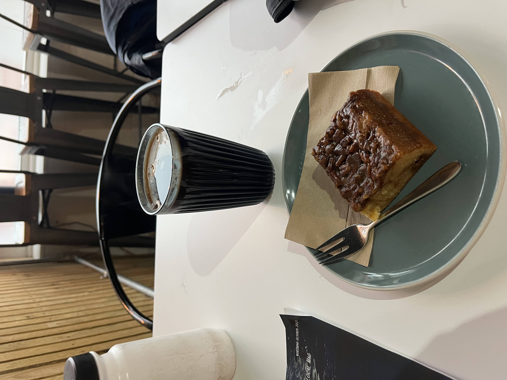

Pendant que je prends mon café, je trouve un camping pour ce soir. J’avais initialement prévu de bivouaquer à nouveau, mais après la nuit dernière et sans avoir repéré de spot convaincant, je préfère assurer le coup. Le camping est à 10 km de ma trace, coûte seulement 10 £ et semble ok. Il est officiellement fermé pour la saison, mais la dame que j’ai au téléphone accepte gentiment quand même.

Je reprends la route vers midi, le long de la côte. Le vent est dans le dos et le parcours est très agréable. À midi, je profite d’un rayon de soleil dans un petit parc pour sortir le réchaud et préparer mes nouilles instantanées. Petit passage à la supérette pour compléter le repas avec quelques gâteaux et un soda.

Je quitte ensuite la côte pour un détour dans les terres.  Vers 14h, grosse baisse d’énergie. La nuit écourtée, mon repas léger, et une alimentation irrégulière sur le vélo ont dû tous jouer. Je m’arrête donc sur un petit pont en pierre au-dessus d’un ruisseau, m’allonge pour une sieste de quinze minutes et fais le plein de sucre : soda, plusieurs barres et cacahuètes.

  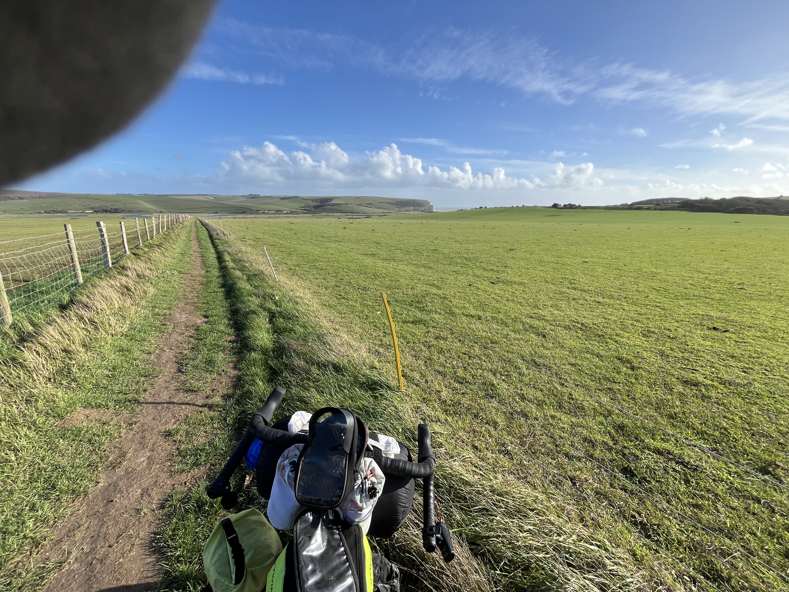

  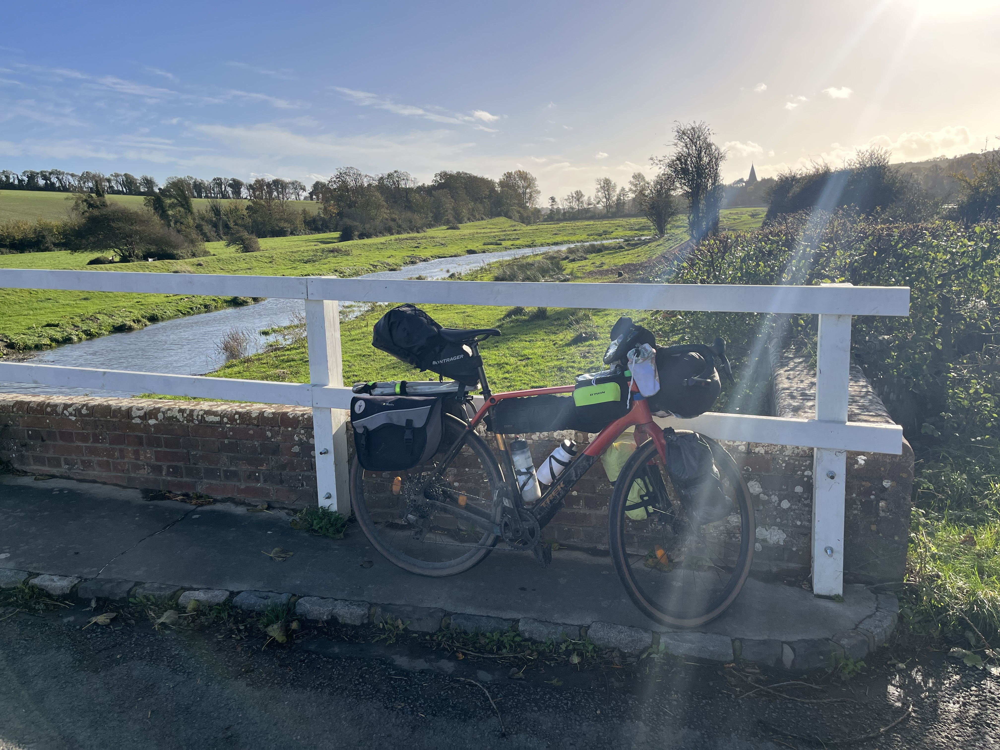

J’en profite pour modifier légèrement ma trace afin de réduire quelques kilomètres. Dans une petite ville, nouvel arrêt ravitaillement : il me reste encore une cinquantaine de kilomètres et je veux éviter de retomber en panne d’énergie. Je trouve une boutique de cigarettes électroniques qui vend aussi des boissons énergisantes et me permet de remplir mes gourdes, et quelques kilomètre plus loin une autre supérette plus loin où je prends banane et un autre soda.

Après cette nouvelle dose de sucre, mon GPS m’annonce une route rout droit à travers les dunes avant de retrouver la côte. Je ne sais pas si c’est le placebo ou le regain d’énergie, mais je me mets à appuyer à fond sur les pédales. Je vole sur la route, aux 175 bpm de tarte à la myrtillle de le Wanski en haut parleur

Je retrouve la côte et reprends la direction d’Hastings. Mais le soleil se couche déjà vers 17 h. Je sors tout mon attirail pour être bien visible et attaque les dix kilomètres de détour qui me séparent du camping dans les terres, avec 250 m de D+ au programme.

Heureusement que j’ai mes éclairages. La première moitié se fait sur une route très fréquentée et peu agréable à vélo, avec les voitures qui passent à toute vitesse. La seconde traverse une forêt, où mes 150 lumens montrent leurs limites. Je complète avec ma lampe frontale pour avancer plus sereinement. Il faudra que j’investisse dans une meilleure lampe avant pour les prochaines sorties nocturnes….

J’arrive enfin au camping dans le noir complet. Dur dur d’ouvrir la grande barrière métallique retenue par une chaîne. Derrière, un immense champ d’herbe avec quelques caravanes. Je suis le seul campeur sous tente ce soir. Je suis les traces de pneus pour trouver l’accueil et les sanitaires, puis installe ma tente à proximité.

Alors que je déballe mes affaires à la lumière de ma frontale, une voix derrière moi me fait sursauter. C’est un caravanier polonais qui m’a vu arriver et vient me saluer!

  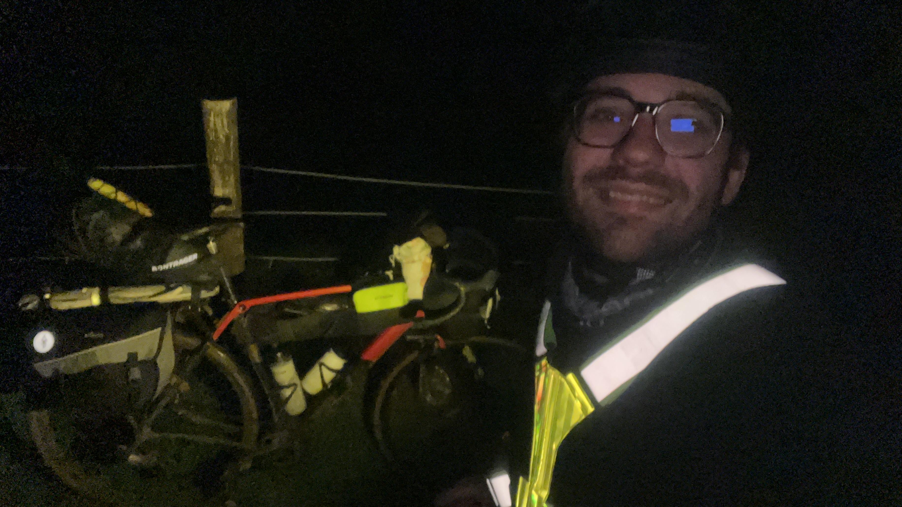

  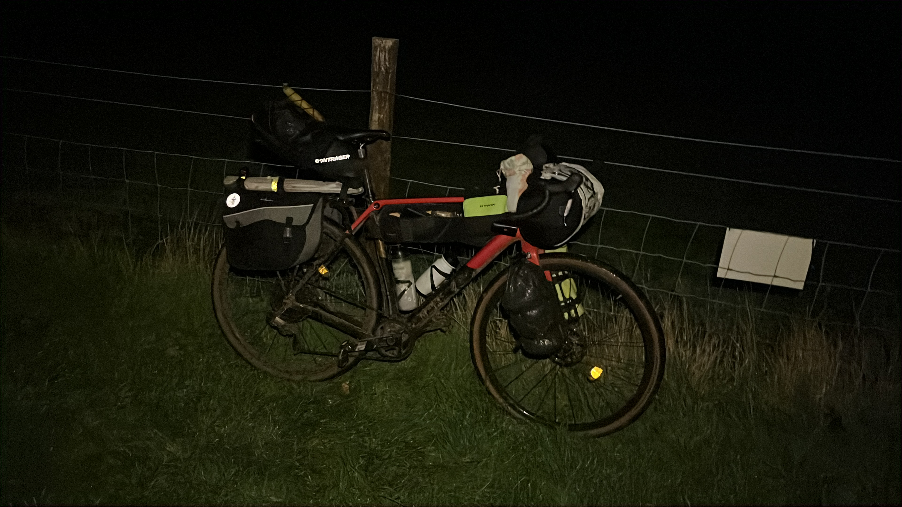

J’ai du mal à me motiver pour aller me laver et préparer à manger. J’en profite au moins pour faire sécher à l’intérieur mes vêtements encore humides. Puis je sors finalement le réchaud : après 96 km et 840 m de D+, la montre annonce environ 4 000 kcal dépensées!

Au menu : ma fameuse purée réhydratée aux protéines de soja épicées, accompagnée de sandwiches avec le reste de mon pain et du seitan épicé sous vide acheté à Bristol.

Il me reste à revoir la trace pour demain, histoire de retrouver la côte sans ajouter trop de kilomètres inutiles. Si tout se passe comme prévu, prochaine étape : une nuit à l’hôtel à Douvres avant le ferry jeudi matin !

# lundi 26 octobre 18:56

J’aurai finalement passé quelques jours à Portsmouth pour éviter le gros de la tempête. j’ai réussi à prendre le ferry samedi matin pour rejoindre l’île de Wight et retrouver mon ami Sripad! J’ai quand même été trempé le temps de faire les 15 km qui sépare le port de sa maison avec vue sur la mer !

  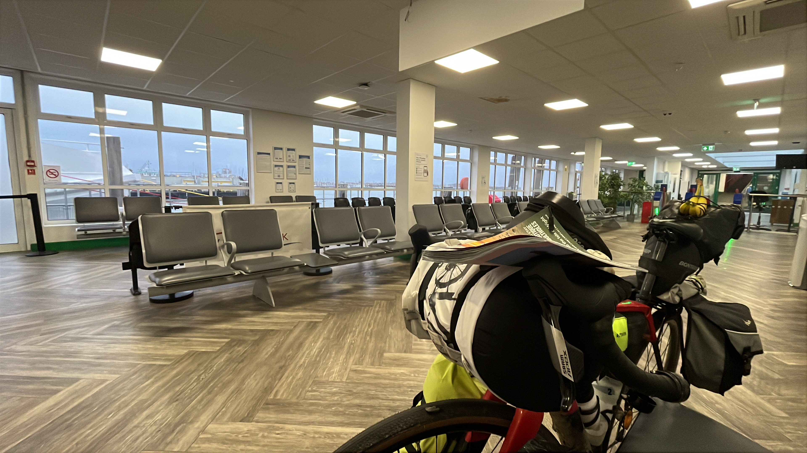

  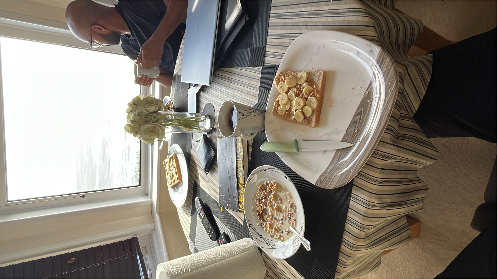

Dimanche matin, retour vers Portsmouth sous le soleil, mais avec beaucoup de vent. J’ai juste eu le temps de manger un burger trop cher sur le port avant de reprendre le ferry. retour à l’hôtel pour la soirée, et le concert de Sea Power, qui était un peu le prétexte initial du voyage!

  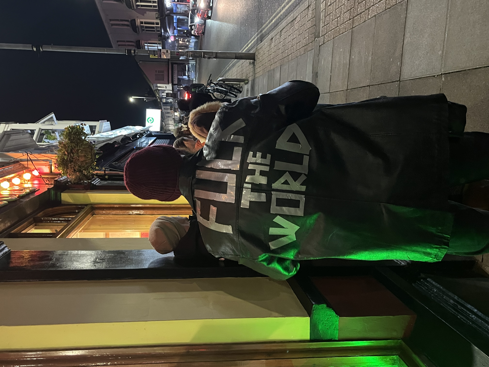

  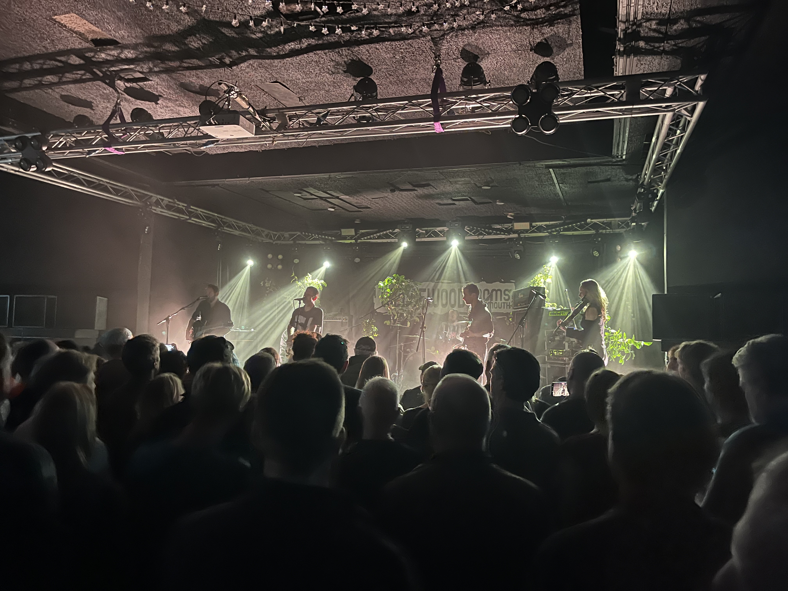

Ce lundi matin, grosse pluie jusqu’à midi. Je profite donc du late check-out de l’hôtel, je mange un morceau, puis je reprends la route direction Brighton à midi, avec environ 70 km au programme et tout plat

Mais comme toujours, les national cycle way anglaises sont très décevantes, je commence par une pseudo-piste cyclable le long d’une route nationale, qui est comme souvent en Angleterre de très mauvaise qualité. Je décide donc de faire un détour pour éviter cette portion, mais un train de fret arrêté sur les voies bloque tous les passages à niveau sur près de 3 km.

  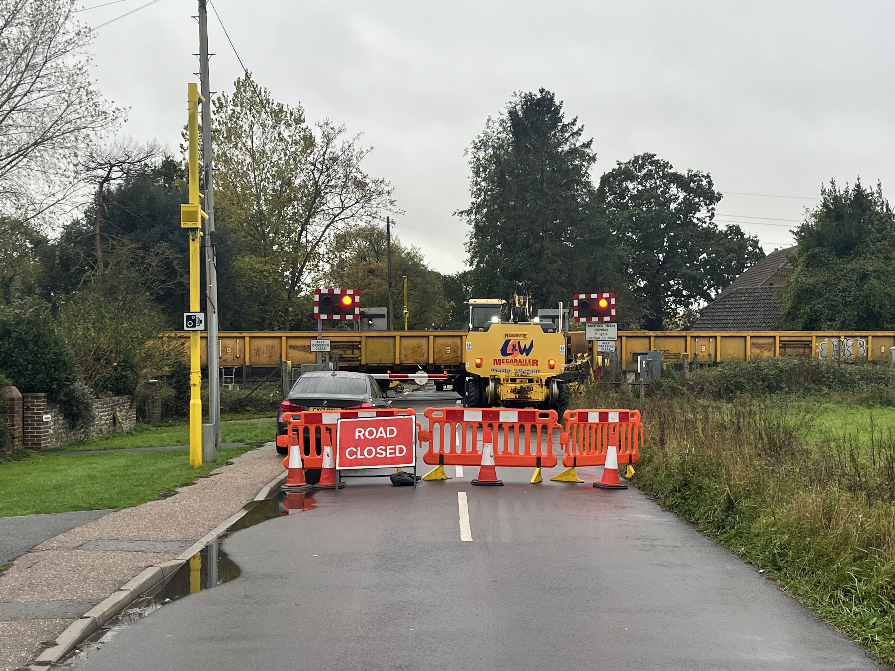

Je finis par retrouver la campagne, mais mon GPX dégotté en ligne m’envoie ensuite sur une route privée qui traverse en réalité une immense ferme interdite à la circulation. J’improvise un passage par les champs et la boue. Au passage, je perds même mes aérobananes!!

Quand j’arrive enfin sur la côte, le vent du sud-ouest me pousse bien sur les longues digues partagées, mais heureusement avec très peu de piétons vu la météo et la période. Le soleil se couche vers 17 h et il fait nuit à 18h

  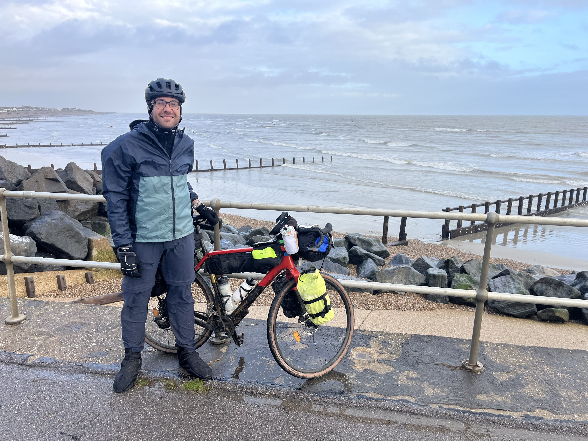

  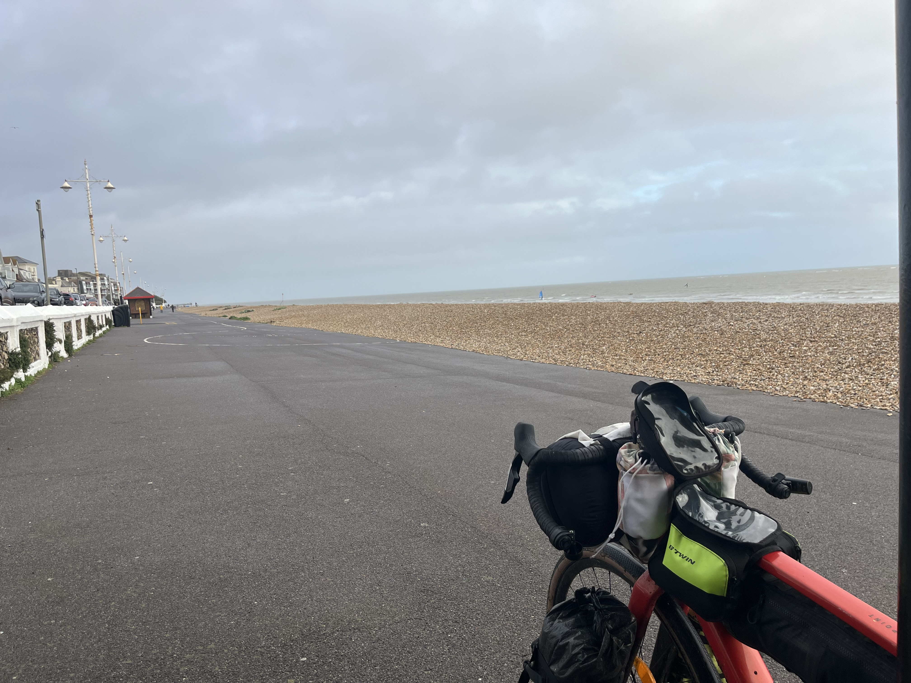

J’arrive finalement à destination, dans un parc boisé sur les hauteurs de la ville pour un nouveau bivouac. Demain, réveil matinal pour plier bagage avant l’arrivée des promeneurs comme toujours

  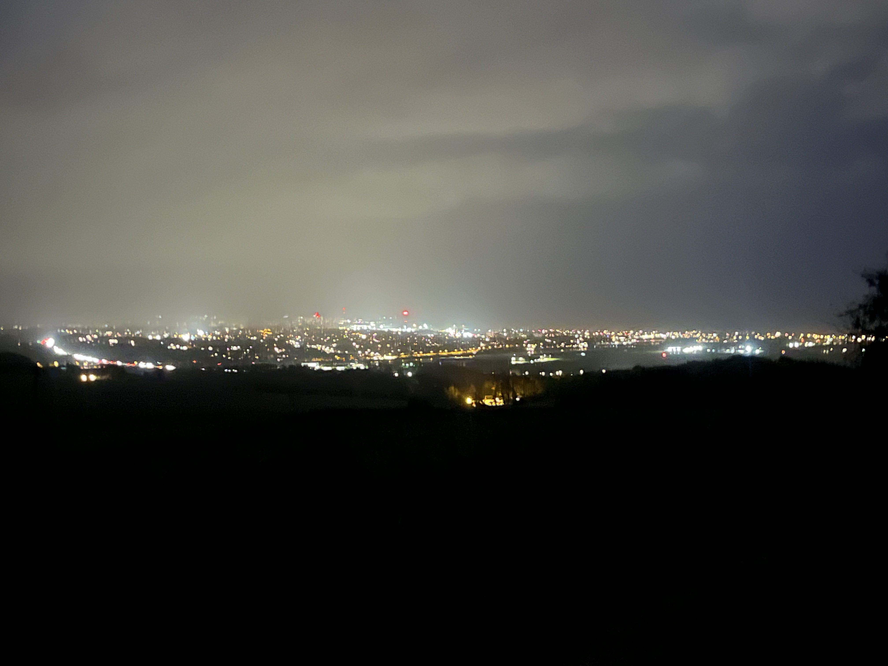

# jeudi 22 octobre 18:28

La nuit a été un peu pluvieuse, et j’ai improvisé un tarp avec ma couverture de survie pour éviter de me faire arroser dans la tente qui perd en étanchéité!

  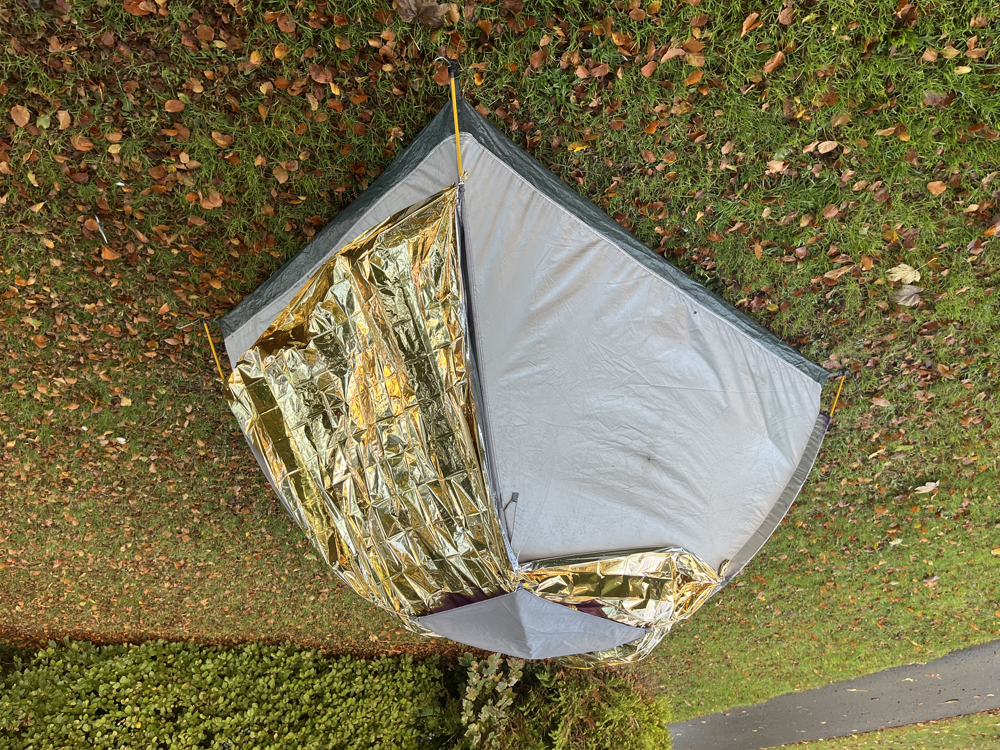

J’ai donc pris mon temps ce matin, en attendant le soleil pour faire sécher un peu la tente et mes affaires. Petit-déjeuner tranquille dans la grande salle commune, que j’avais entièrement pour moi tout seul à nouveau

Départ tardif pour les 85 km prévus aujourd’hui. Le début est assez rude, avec beaucoup de cailloux et de boue, avant de devoir traverser la ville au milieu des voitures. Et juste au moment où je parviens enfin à en sortir et à retrouver une ambiance plus forestière… nouvelle crevaison, à l’arrière (qui avait tenu le tubeless jusque là). Passage en chambre pour ne plus être embêté, je déteste les ronces anglaises

J’en profite aussi pour faire un gros ravitaillement dans un immense Tesco ce qui me fais encore plus perdre du temps. À midi, je n’avais parcouru que 20 km, alors que j’espérais en avoir déjà fait 45.

Heureusement, le milieu de journée est bien plus agréable, avec de belles routes de campagne et très peu de circulation. Pause déjeuner au calme, avec au menu bagel sauce tomate au fromage au pepperoni végan, en écoutant le podcast ultra talk du créateur de la race across series

  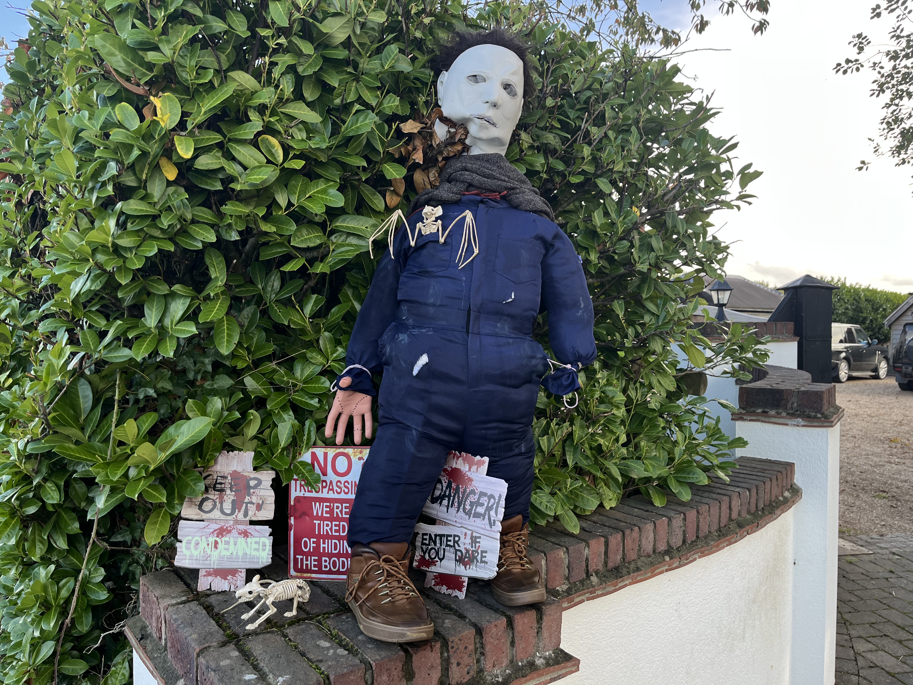

  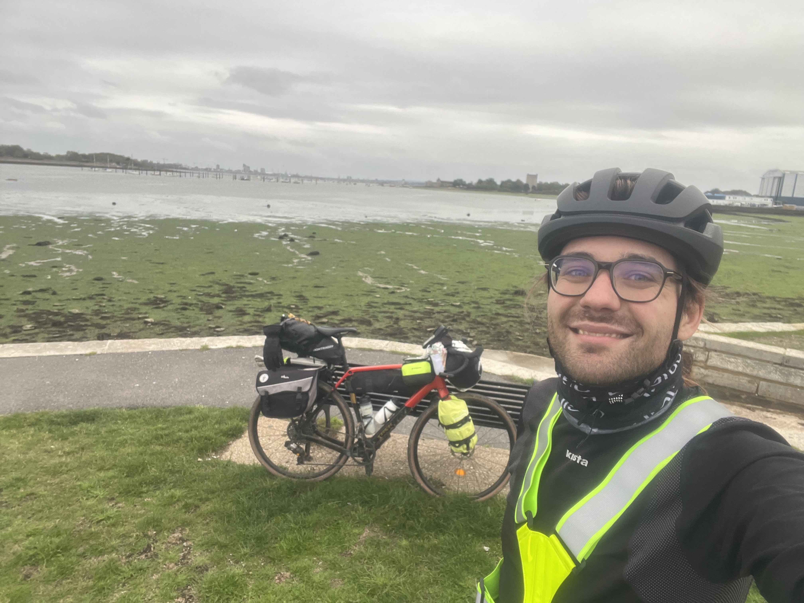

L’après-midi, je me rapproche de Portsmouth. Geovelo m’annonce 98% de voie cyclable pour l’heure de trajet pour arriver à l’hôtel, génial !! Sauf que en Angleterre, tous les trottoirs sont considérés comme des voies partagées dont je vous laisse imaginer l’état…

  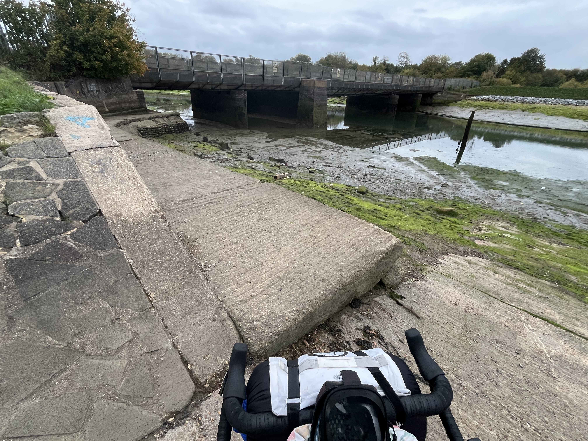

Beaucoup de voitures, des itinéraires compliqués, des passages sur les trottoirs, des escaliers… arrivée pénible!

  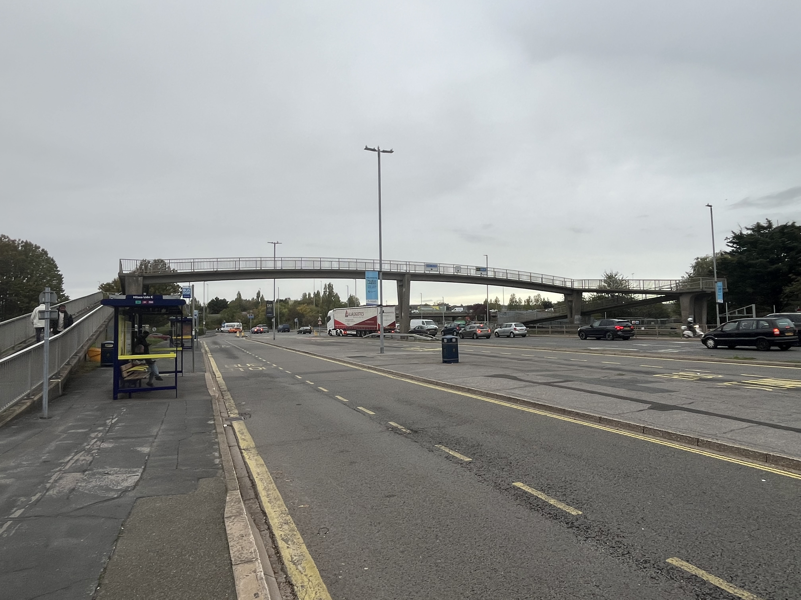

Mais ça y est, je suis arrivé à l’hôtel. Et avec les annulations de ferries annoncées pour demain, la décision de rejoindre Portsmouth aujourd’hui etait la bonne. Sinon, je serai coincé à Lymington sans de solution simple pour rejoindre l’île de wight ou Portsmouth pour mon concert dimanche, et aurait du traverser la tempête à vélo ! Le vent et la pluie commencent déjà à arriver ce soir, demain visite possible tranquille de la ville et j'aviserai pour voir si je tente l'île de wight samedi et dimanche pour y rejoindre mon ami Sripad !

# mercredi 21 octobre 16:59

Finalement, je serai resté trois jours chez Shrestha à Bristol. Ça a été l’occasion de bien me reposer, de laver et de faire sécher tous mes vêtements, de beaucoup dormir et de repartir sur de bonnes bases. On a célébré Durga Puja, une fête traditionnelle du West Bengal, et l’anniversaire de Shrestha ! J’ai aussi revu un certain ingénieur de chez Dyson avec qui je m’entends très bien …

  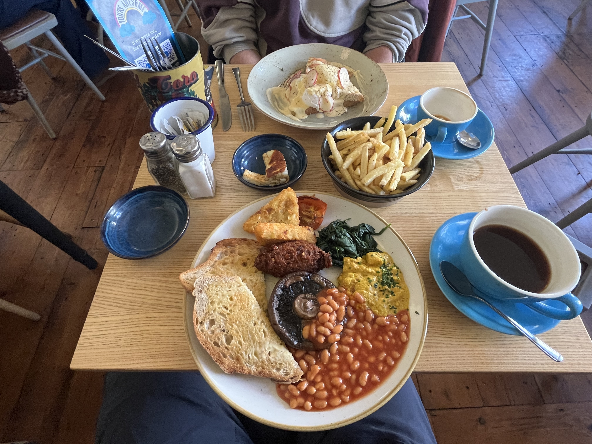

  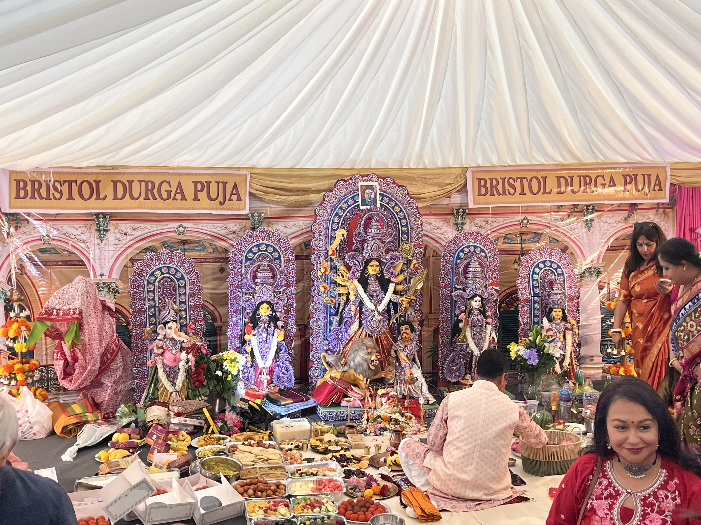

Me voilà donc de retour sur la route, avec quelques changements de plan. Une tempête approche des côtes anglaises, avec un pic annoncé vendredi matin. Mon ferry pour l’île de Wight prévu pile ce jour là risque très fort d’être annulé. Je vais finalement rejoindre Portsmouth en deux jours, puis rester à l’abri à l’hôtel le temps que la tempête passe. Je verrai samedi matin les conditions pour traverser jusqu’à l’île de Wight.

  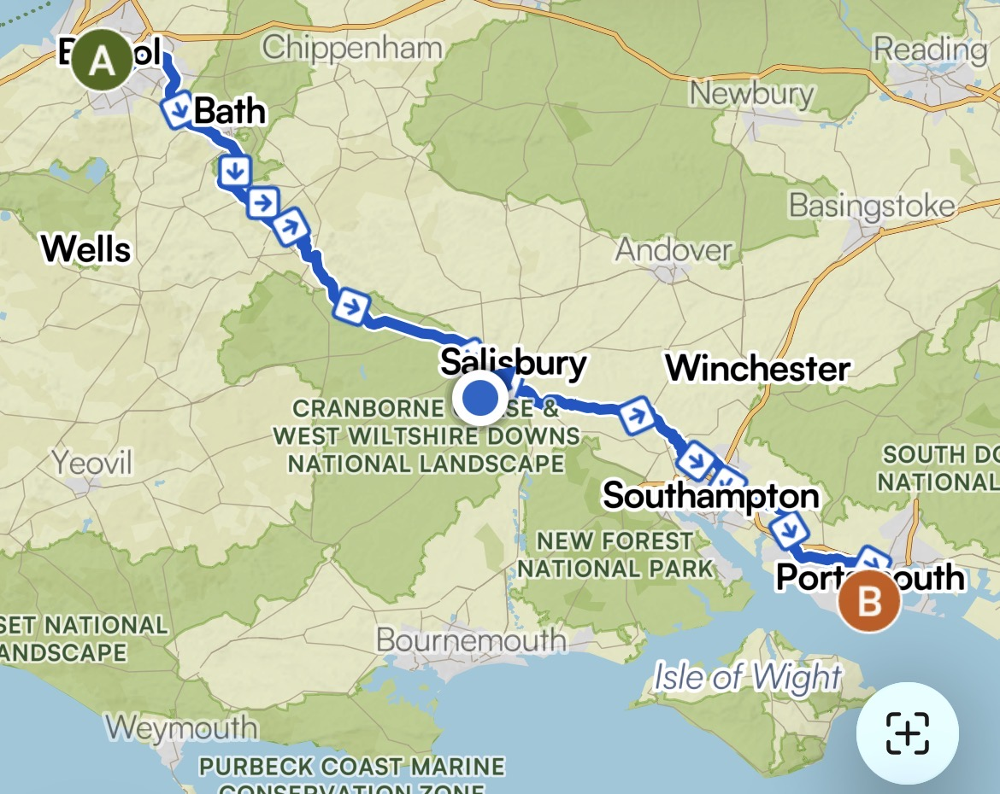

En attendant, les 95 km et 900 de D + sont passés très vite aujourd’hui, je suis arrivé au camping à 14 h 30 ! Forcément avec un vent à 50km/h dans le dos ca avance mieux! Le camping est presque vide, la salle commune est tres grande et a une cuisine tout équipée et un super distributeur d'eau bouillante pour ma soupe miso !

  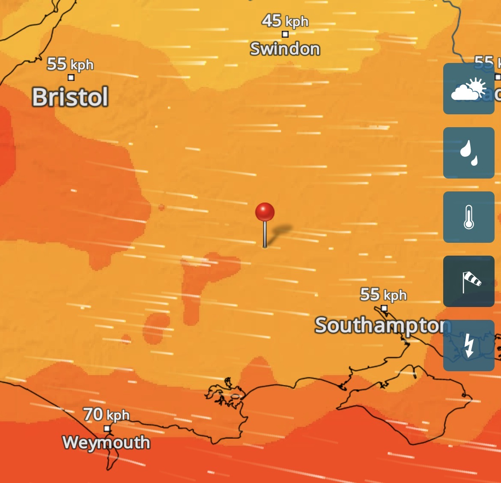

  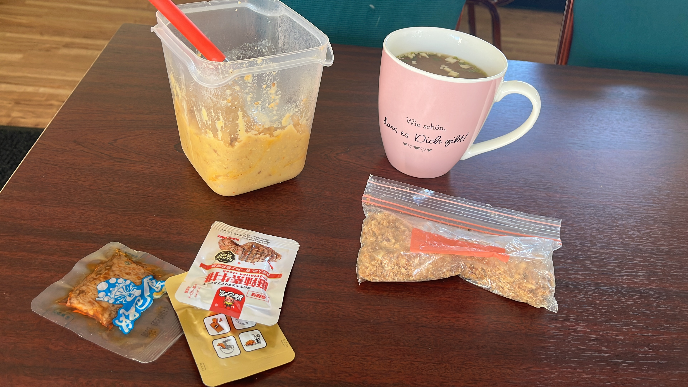

# samedi 17 octobre 21:34

Nuit très humide et très froide à 5 °C. Mais mon sac de couchage Cumulus a très bien tenu, donc très content. J’arrive par contre doucement aux limites de mon setup : la tente d’occasion qui commence à perdre son étanchéité et mon matelas avec son R de 2,2 sont les facteurs limitants pour les nuits les plus froides ou sous la pluie. Je pense chercher une bombe etancheifiante pour finir le voyage un peu plus sereinement surtout que de fortes pluies sont annoncées pour la suite

Réveil lent et tranquille avec le soleil. Gros luxe du camping : un micro-ondes à disposition, donc pas besoin de sortir le réchaud pour préparer le café et le porridge Je pars un peu tard à 10h alors que je vise généralement 8:30-9h

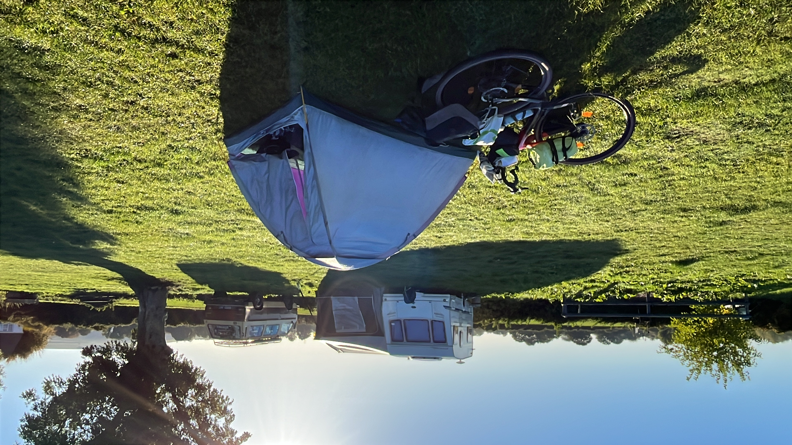

Aujourd’hui longue et plate journée : 85km pour 400 D+! Le début se déroule comme d’habitude sur de belles routes de campagne, avec peu de circulation et tout plat

En fin de matinée, j’arrive le long de la rivière Avon, où m’attendent une vingtaine de kilomètres de chemin de halage. Malheureusement, le chemin enchaine gravier, cailloux, terre, flaque et revêtement irrégulier, le tout sur un itinéraire très fréquenté par les promeneurs, les autres vélos et les chiens. On se croise toujours avec le sourire avec un petit « Thank you », « Good morning », mais forcément, ça n’avance pas très vite.

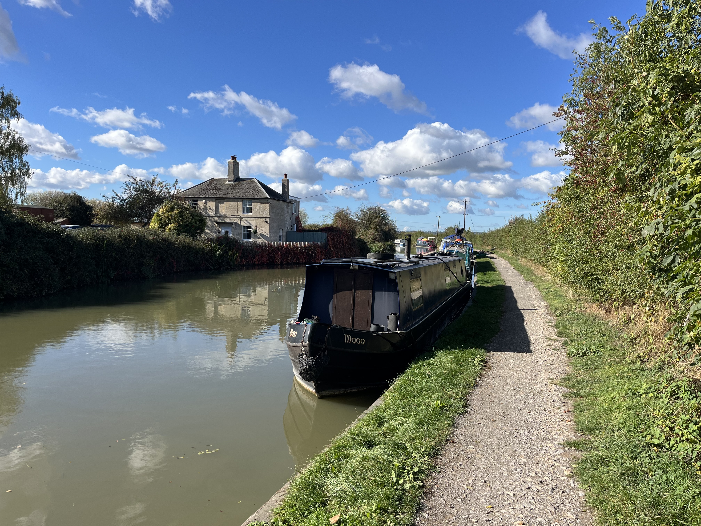

À force d’encaisser les cailloux, les épaules commencent à souffrir. Je finis par faire une longue pause à la mi journée, avec une petite sieste au bord de l’eau. Et là, c’est dur dur de repartir ! Je commence à pester contre ce chemin interminable qui me fait regretter les montagnes russes d’hier qui avaient pour elles d’être sur une route très lisse.

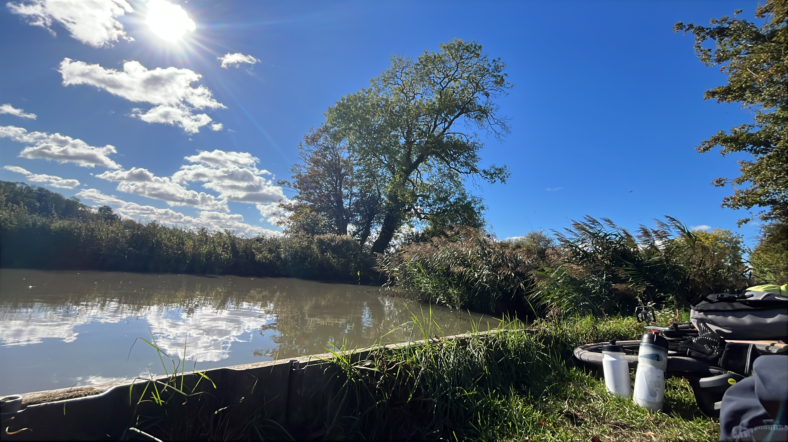

La délivrance arrive lorsque je rejoins la piste cyclable des Two Tunnels, qui m’emmène vers Bristol. Je traverse le long tunnel d’un mile, qui accueille chaque année une course d’ultra-running ([voir un vidéo reportage ici](https://youtu.be/E0Qt3RxzP0s?is=hzrt1WAqdDmXlomh)).

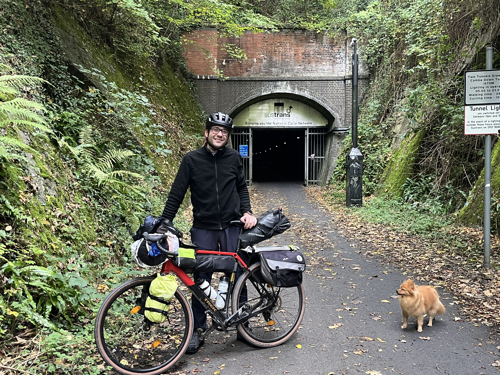

Ça monte un peu, mais je m’envole : je connais cette route que j’ai fait cet été avec un vélo de location et Bristol est au bout du chemin.

J’arrive en ville vers 18 h après un dernier ravitaillement et pause sur le parking d’un Lidl. Petite photo finish au bord du canal et à l’université 

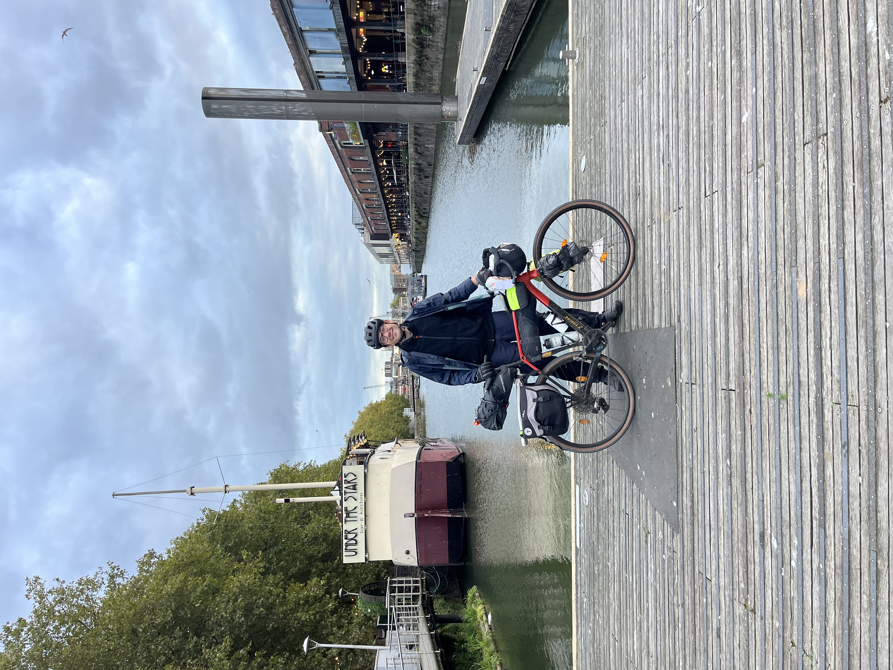

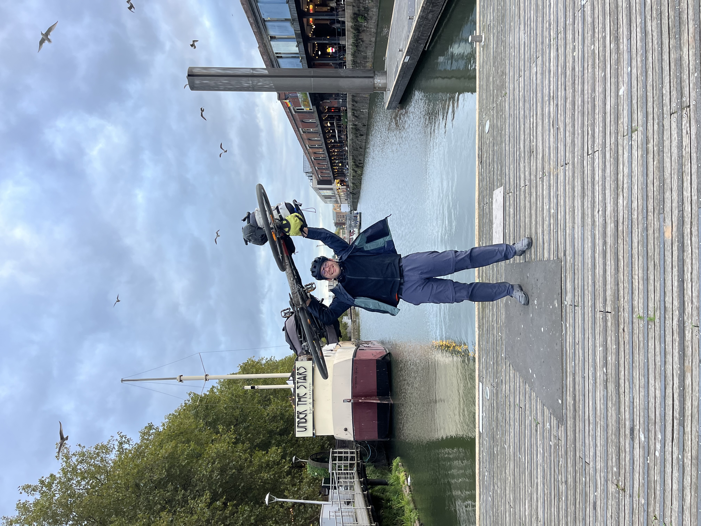

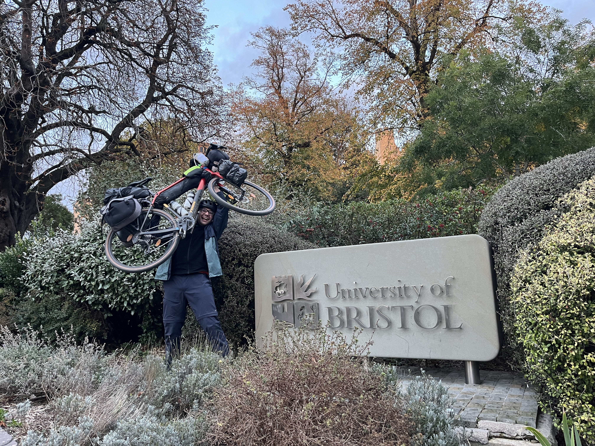

plus qu’une dernière côte pour rejoindre l’appartement de Shrestha , qui va m’héberger pour les deux prochains jours et dont c’est l’anniversaire le 20 octobre !

Au programme ce soir : pizza

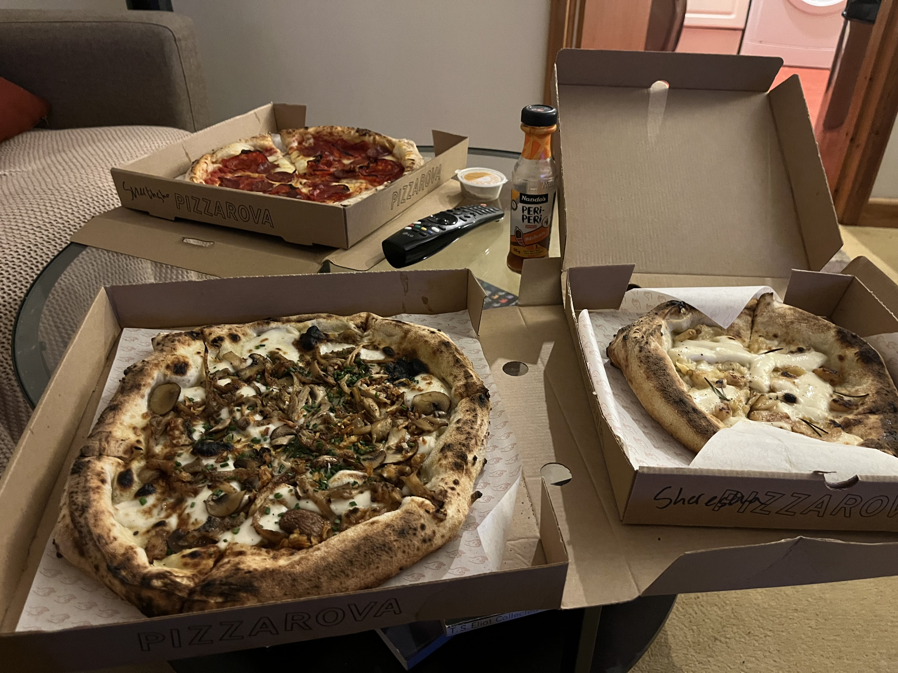

# vendredi 16 octobre 19:14

Le départ du spot de pique-nique est un peu plus difficile que prévu : je suis vraiment bien installé au soleil, mais il faut bien finir la journée et rejoindre le camping.

Je passe l’après-midi à traverser une immense zone militaire, avec un aérodrome et plus de 15 km de route en ligne droite à travers les champs. Quelques rares voitures passent à toute vitesse, et le dénivelé est un peu frustrant

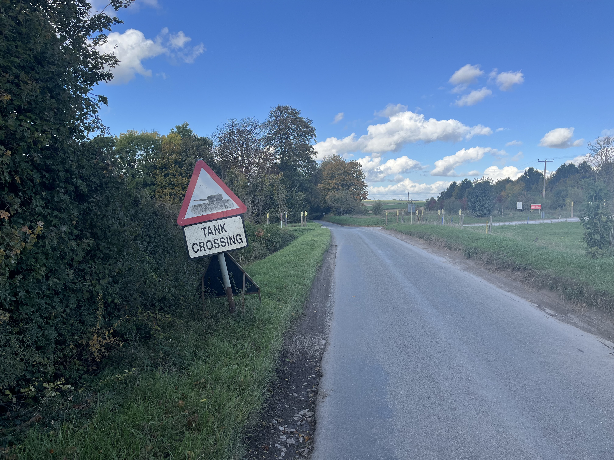

Pour mes matheuses et matheux, la courbe de dénivelé ressemble à du (x+\sin(x)), avant de se terminer par un (-\delta) Dirac. Pour les autres, c’est une sorte de montagnes russes qui ne fait que monter, avant de se terminer par une descente très raide. Jy passe mon temps à freiner un peu frustré de perdre tout le dénivelé positif accumulé

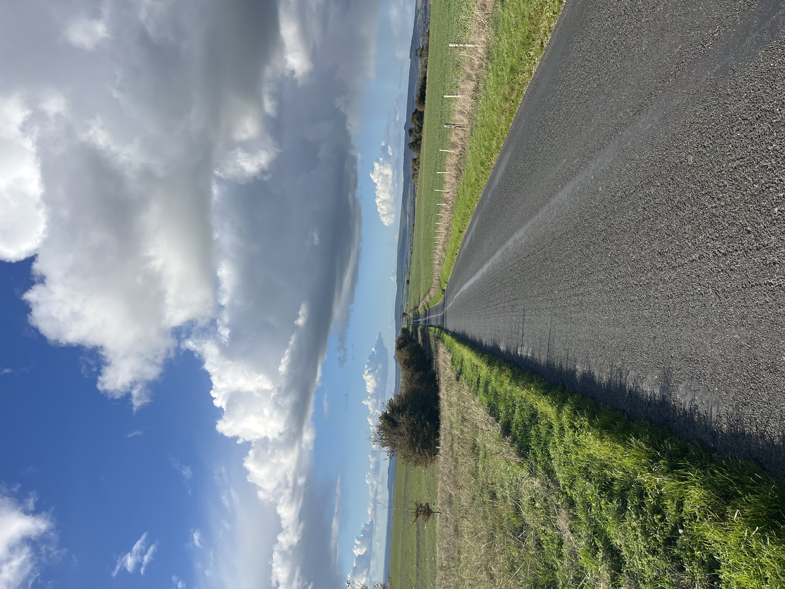

Plus que 5 petits kilomètres pour rejoindre le camping, derrière une “inn” typique au bord d’une route nationale.

c’est le premier camping du voyage où je retrouve d’autres personnes, et très bonne surprise : douches modernes, propres et l’eau est bien chaude.

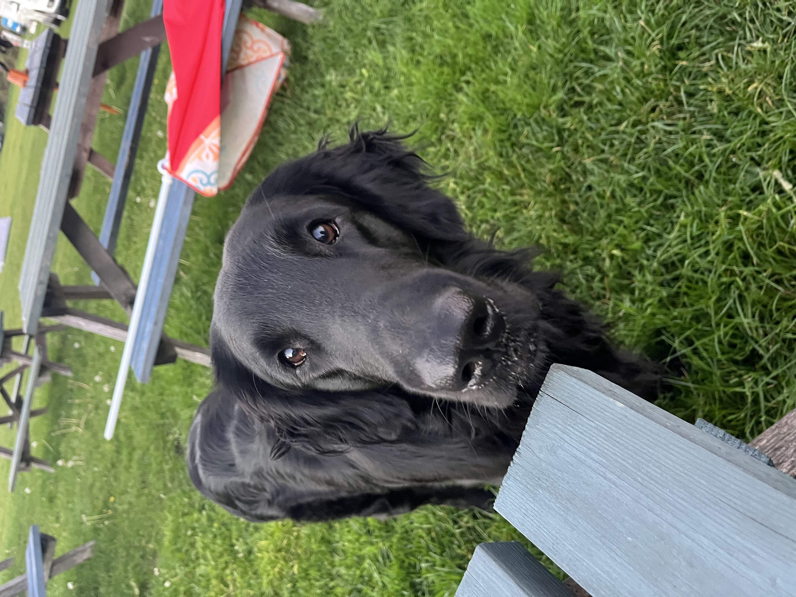

Demain arrivée prévue à Bristol dans la soirée. Très hâte d’y être !

# vendredi 16 octobre 13:33

Réveil au sec après une nuit très satisfaisante, surtout quand j’entends la pluie tambouriner sur le toit de la véranda dans laquelle je suis très gentiment hébergé. Quel plaisir de retrouver au matin ma serviette, mes chaussures et mes chaussettes sèches !

Mes hôtes redoublent de gentillesse et m’invitent à partager un petit déjeuner : pancakes au miel et jus de citron, café et orange. J’aurai vraiment passé un formidable moment chez Mark et Jill. Merci encore beaucoup si vous lisez ces lignes !

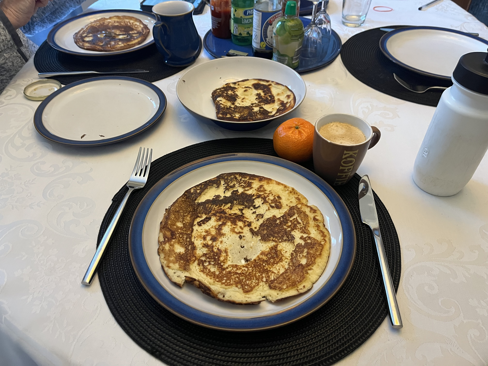

Je reprends la route alors que le soleil commence à sécher les chemins, même s’il fait encore assez frais. Je finis même par mettre mes sur-chaussures de vélo, le vent est fort et froid.

La matinée traverse de grands champs réservées aux exercices militaires. Sur une grande route droite, beaucoup de vent

Petite pause imprévue dans un Aldi qui me rappelle la maison. J’y prends petit pique-nique, puis direction Stonehenge

L’accès proche des pierres est interdit au public mais je fais la photo souvenir qui va bien

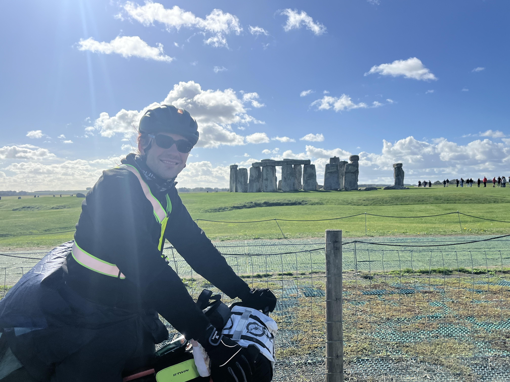

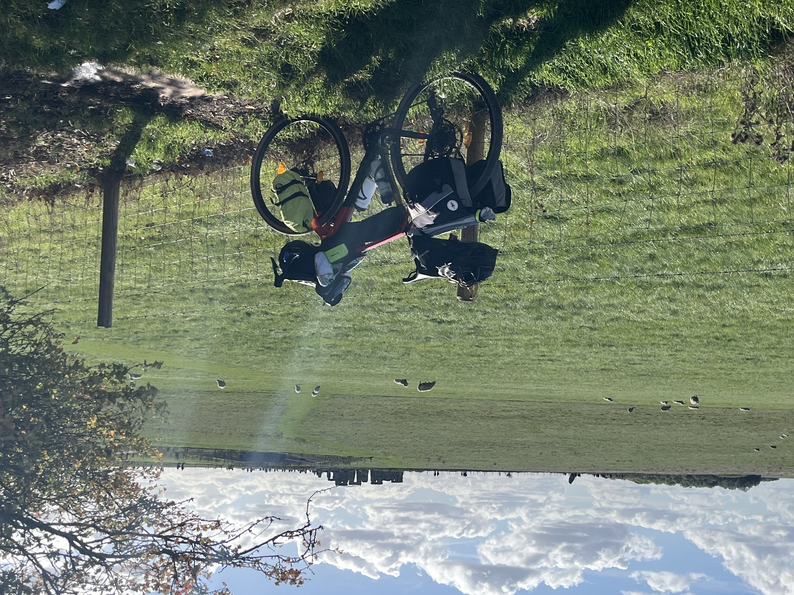

Je finis par trouver un petit parc, au menu du pique-nique, de gauche à droite :

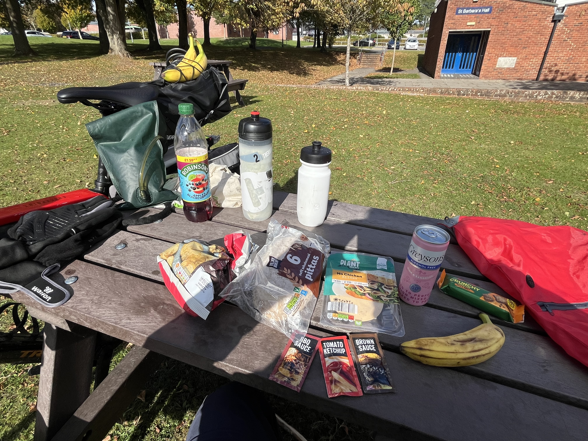

* Ma flasque d'eau que j’utilise pour remplir mes bidons avec du concentré de jus de pomme.
* Les chips de la veille.
* pain pita complet.
* Des tranches de poulet végan.
* Un gin-tonic à la rose 0%.
* sauce maison pour le sandwich composée de sauce barbecue, de ketchup et de brown sauce, piquée au restaurant il y a quelques jours.
* En dessert, une aérobanane et une barre de céréales à l’avoine.

30km pour finir la journée !

# jeudi 15 octobre 20:32

Réveil au camping dans une ambiance bien humide. Ma tente mes chaussures et mes chaussettes sont trempées

 surprise : mon pneu avant est à nouveau dégonflé. Je change finalement de chambre à air pour essayer d’être tranquille pour la journée.

Au programme : 74 km et 820 m de D+. Je quitte le camping un peu tard, vers 9 h 30, mais la matinée se déroule très bien. Encore une fois, de belles routes de campagne désertes et de jolies descentes

Vers 13 h, pause dans un petit restaurant au bord d’une route passante pour bien recharger ma batterie externe à fond.

L’après-midi est un peu plus compliquée. détour pour éviter une nationale que je n’avais pas anticipée et nouvelle crevaison à la roue avant…. Sauf qu’au moment de démonter la chambre à air, impossible de trouver le trou. Je la regonfle à fond pour voir si elle tient.

Je poursuis vers Winchester, qui est une ville très vallonnée. Dans une grosse côte au milieu des voitures, mon pneu se dégonfle à nouveau. Arrêt, démontage et inspection de la chambre à air. Cette fois, je finis par trouver le minuscule trou et je le répare avec une rustine. On croise les doigts

Après avoir traversé Winchester, j’arrive à King’s Somborne, où je rachète quelques provisions. Jhesite entre trouver un coin pour bivouaquer ou parcourir les 8 km qui me séparent du camping ? Je décide finalement de tenter un nouveau bivouac,. je toque à la porte d’une maison pour remplir ma grosse poche à eau de 3 litres et mes bidons pour me laver et cuisiner ce soir et demain matin. Un monsieur très sympathique à la barbe blanche, aux cheveux longs et qui porte un pull de l’ESA m’ouvre et accepte volontiers de remplir mes gourdes.

Sa compagne me propose ensuite quelque chose à manger. Je refuse dans un premier temps, mais elle insiste gentiment et me voilà attablé avec Mark et Jill ! Iels me racontent leurs années passées aux pays bas, où Mark travaillait à l’ESA sur les satellites météo qui détectent les éclairs, des géostationnaires qui capturent à une fréquence de 1 kHz si j’ai bien retenu les explications !

Au moment de repartir pour trouver mon coin de bivouac, je consulte une dernière fois les prévisions météo. Beaucoup de pluie pendant la nuit. Le soleil commence également à se coucher, et l’idée de planter la tente sous une grosse averse devient moins séduisante.

Je demande à mes sympathiques hôtes s’il serait possible de planter la tente dans leur jardin. Ils acceptent volontiers, mais vont même plus loin : ils me proposent un lit de camp dans leur grande véranda !

Bonne nuit au sec et à demain !

# mercredi 14 octobre 18:55

Réveil très sympathique sur mon lieu de bivouac. La nuit s’est très bien passée. C’est sûr que lorsqu’on est tout seul dans la forêt, on entend plein de bruits bizarres et on se demande si c’est un sanglier, un chien qui aboie au loin ou simplement une voiture qui passe. Mais tout s’est bien passé !

Je démonte la tente avec le lever du soleil, puis profite de mon petit déjeuner avec une très belle vue depuis le sommet de la colline.

Encore quelques petits soucis techniques au réveil : le porte-bagages qui grince et qui nécessite un resserrage complet, la boue et l’humidité qui font grincer mes freins, et mon pneu avant qui est bizarrement à plat. Je soupçonne plutôt la valve de la chambre à air qu’une nouvelle crevaison. Après un petit check-up mécanique et des préparatifs rapides, c’est parti pour une journée de 74 km et 753 m de D+ prévus, beaucoup plus roulante que la veille !

La première partie de la matinée traverse un petit marais un peu gras mais calme et sympathique. J’y croise plusieurs randonneurs avant de rejoindre une ville où je profite d’un Tesco pour reprendre fruits et barres

La sortie de la ville est un peu moins agréable, avec pas mal de circulation, mais je retrouve rapidement les routes de campagne, en bon état et presque désertes

Vers midi, le ciel commence à se couvrir et je tombe sur une superbe petite taverne qui m’emmène tout droit à Rivebois (celles et ceux qui ont la référence comprendront). J’y prends un café au coin du feu, discute avec la patronne et évite la pluie de justesse.

erreur stratégique : je n’en profite pas pour recharger ma batterie externe, qui commence à fatiguer après la nuit de bivouac

L’après-midi, du soleil, des routes très roulantes et peu de circulation. Quelques petites montées qui passent relativement bien tant qu’elles ne dépassent pas 5 à 6 %. Au-delà, pas le choix, il faut pousser le vélo mais avec le sourire et la satisfaction d’être en quasi totale autonomie grâce à tout le matériel que je transporte

J’arrive finalement très tôt au camping : 16 h 30 ! Pour me récompenser, petit détour par M&S, ( un supermarché un peu fancy) pour y prendre un soda à la rhubarbe et des chips pour ce soir

Le camping est un immense terrain avec une cuisine extérieure, des bancs, des douches solaires et des toilettes à compost. Le rêve, je me lave même les cheveux

.Je rencontre la propriétaire, qui accepte très gentiment d’emporter ma batterie externe chez elle pour la recharger

Je ne sais pas si c’est parce que je commence à trouver mon rythme ou si je prends un peu trop. La confiance, mais cette journée s’est vraiment très bien passée. De bonnes jambes, un parcours agréable et seulement une petite gêne au genou, qui disparaît au repos, a surveiller et sans trop forcer. Qui veut aller voyager loin ménage sa monture!

Il reste encore quelques éléments à gérer pour la suite du voyage. Le soleil se lève de plus en plus tard et se couche de plus en plus tôt : je dois lever le camp pour le lever du soleil si une grosse journée m’attends pour éviter de rouler trop le soir.

En parallèle, avec la précieuse aide de Véronique, on gère les derniers détails administratifs de la soutenance de thèse par mail interposé! J’ai aussi reçu un coup de fil de France travail qui valide mon allocation chômage! C’est peut etre un signe que je vais pouvoir continuer à voyager encore plus longtemps que prévu qui sait…

update 20:11: je viens de marcher les 400 m qui me séparaient de la maison de la proprio dans le noir, le froid et la brume anglaise brrr c'est Halloween avant l'heure 

# mardi 13 octobre 20:30

Deuxième jour de voyage, et déjà l’une des plus grosses journées prévues: 90 km et 1 000 m de D+. Sauf que la trace s’avère bien plus gravel que prévu, surtout sur la première moitié. Les voies vélo annoncées en ligne sont en réalité des chemins très rocailleux, avec des pierres tranchantes comme des silex.

  Ce qui devait arriver arriva : trois crevaisons successives sur ma roue avant. Les mèches s’enchaînent et tout mon liquide préventif se fait la malle donc : passage en chambre à air. C’est pas super drôle de démonter sa roue avant en plein milieu de la forêt, mais il faut bien repartir ! Je rajoute à ma liste de choses essentielles en voyage à vélo: de l’eau, à manger, de la lumière, et de l’air dans les pneus. Je fais un détour pour trouver un magasin de sport pour reprendre une chambre de secours. dur dur pour le moral

Après seulement une petite quarantaine de kilomètres parcourus avant midi, je trouve une supérette pour manger un morceau. J’ai aussi la joie de profiter d’une petite drache éclair anglaise qui me trempe juste avant d’arriver, mais je suis bien équipé, donc tout roule !

L’après-midi est plus sympa. La deuxième partie de l’itinéraire est un peu plus roulante, avec davantage de routes de campagne, et météo au top.

Une route fermée “même aux cyclistes”  vient compliquer les choses. Elle me force à choisir entre tenter de traverser le parc d’un château / résidence de luxe ou faire un détour par une sorte de nationale limitée à 90 km/h. Je tente ma chance du côté du château, mais on me fait rapidement comprendre qu’il est absolument impossible de traverser le parc privé à vélo. Donc détour de 5 km, avec une portion le long d’une nationale peu agréable.

dernier obstacle de la journée : 1 km de pente à 12 %. Je traîne mes 125 kilos cumulés pied à terre en poussant jusqu’en haut

Les derniers kilomètres se déroulent sur une petite route forestière qui serpente entre de belles propriétés, avec leurs maisons d’architecte et leurs grands jardins

Il me reste encore 15 km jusqu’au camping que j’avais repéré, mais je tombe sur un petit coin de parc nature entre des propriétés privées. Je trouve une super vue depuis le sommet de la colline avec un banc pour moi tout seul!

J’y mange un morceau en profitant du paysage, puis j’attends le coucher du soleil pour installer la tente à l’écart des sentiers.

Au final, 88 km et 1 200 m de D+ au compteur! Demain réveil tôt pour ne pas me faire surprendre par les promeneurs matinaux!

pareillement j'enverrai les photos plus tard bizarrement on capte mal dans la forêt 

# lundi 12 octobre 19:18
Après 20 minutes de vélo entre la gare de Calais et le ferry, je passe les contrôles aux frontières rapidement. Il me reste ensuite 1h30 à attendre avant l’embarquement. je rencontre un couple anglais fort sympathique avec qui je passe toute la traversée. On discute beaucoup, notamment de leurs voyages à vélo entre leur péniche en Angleterre et les quatre coins de la France! 

Arrivé à Douvres, je longe la côte pendant une quinzaine de kilomètres avant de tourner dans les terres. en haut des White Cliffs, le vent est très fort, de face et de côté. en plus je prends doucement en main mon vélo chargé à bloc, ce n'étais pas facile facile. sur le retour à la fin de mon voyage je devrai l'avoir dans le dos !

Au moment de tourner dans les terres, malheur : une sacoche de mon porte-bagages arrière est restée ouverte et j’ai perdu une pochette ! Il y avait dedans ma casquette, mes couvre-chaussures et mes gants d’hiver. je repars dans l’autre sens pour remonter environ 5 km. Je finis par retrouver la fameuse sacoche au bord de la route, pile au moment où je commençais à perdre espoir. Ouf !

Demi-tour, et cette fois, direction les petites routes de campagne anglaises. Pas mal de D+ moi qui suis habitué au plat pays mais très peu de voitures. 

La météo se gâte progressivement. Après le vent, place à la pluie et au brouillard. J’allume tous mes phares et reste bien visible tout roule

après 45km, le camping est tout proche et je devrais y arriver vers 17 h

 là, malheur bis : le dieu du tubeless semble vouloir ma peau. Une entaille de 3 mm sur le pneu avant refuse de se reboucher avec le liquide préventif. obligé de mettre une mèche dans mes pneus tout neufs, qui ont à peine 50 km au compteur. Un peu frustrant, mais c’est la vie !

Enfin arrivé au camping, qui est plutôt bien équipé, j'ai un grand champ pour moi tout seul. Je suis juste à côté des points d’eau et j’ai accès à une petite kitchenette abritée et des douches. J’installe rapido ma tente et mange ma purée PST épicée lyophilisé (20/20)

Merci pour tous vos commentaires!! je mettrai des photos plus tard ici car j'ai très peu de réseau !

# lundi 12 octobre 7:03

Bonjour tout le monde ! j'écris ce message depuis le train pour Calais qui m'emmène au port pour prendre mon ferry ! j'ai pas mal hésité à écrire en anglais ou en français mais je pense continuer en français !

j'ai rendu mon manuscrit de thèse fin septembre et je pars maintenant pour mon voyage à vélo en Angleterre ! Le prétexte de ce voyage étant un concert à Portsmouth le 25 octobre du groupe de rock anglais "Sea Power" que j'affectionne énormément!

je prends ce matin un train Lille - Calais puis un ferry pour Douvres qui devrait me faire arriver sur place vers midi heure locale, pour ensuite rouler environ 50 km jusqu'à mon premier camping près de Ashford!

ma trace est très majoritairement route de campagne ou chemin compact, sauf sur mes 2-3 derniers jours qui sont très (peu être trop ?) Gravel pour éviter de longer les villes côtières assez urbaines. je prendrai normalement un morceau de la "South Down Way" qui est un itinéraire VTT assez réputé !

mon vélo est bien prêt avec toutes mes affaires, je suis parti avec l'équivalent de environ 10 repas secs à réhydrater fait maison, et quasiment assez de barres et de snack pour tout le voyage (ce qui est certainement bien trop mais j'aurai moins à m'arrêter !)

je teste un peu trop de matériel à mon goût même si j'ai fais le maximum pour tout rouler au moins une fois avant de partir :
j'ai installé un porte bagage et 2 sacoches à l'arrière de mon vélo pour pouvoir transporter mes vêtements chauds (dont je n'ai pas tellement besoin lors de mes sorties printanières) et 2 dry bag de fourche pour y transporter ma nourriture et système de sommeil (matelas, liner de sac)
j'ai aussi un super sac de couchage cumulus tout neuf qui devrais me garder bien chaud!!

j'ai peut être pris un peu trop de matériel je suis très très loin d'être ultra light : le vélo + le matériel pèsent 29.2 kg !! pour un total avec le cycliste de 122.8 kg, 2.2kg sous la limite de charge du trek ouf, sachant que ça devrait aller en s'améliorant sur la route !

<h1>Commentaires</h1>

If you're viewing the English-translated page, the comments won't work. Go back to the normal page (outside of the google traduction environment) to read and leave comments !

  
vous pouvez commenter ici, n'hésitez pas à préciser un pseudo ou votre nom pour que je vous reconnaisse !
 

  <cmmnts-widget
    site-key="my-blog-wieckowiak"
    page-id="uk-trip-wieckowiak"
    max-height="none">
  </cmmnts-widget>

<a href="#comments" class="comments-button">
  💬 Commenter
</a>

     
<h2>End of Page</h2>