# ⸻
#jeudi 15 octobre 20:32

Réveil au camping dans une ambiance bien humide. Ma tente mes chaussures et mes chaussettes sont trempées

B464D426-FCF4-4F25-8096-86AC44D0D2A2.jpeg

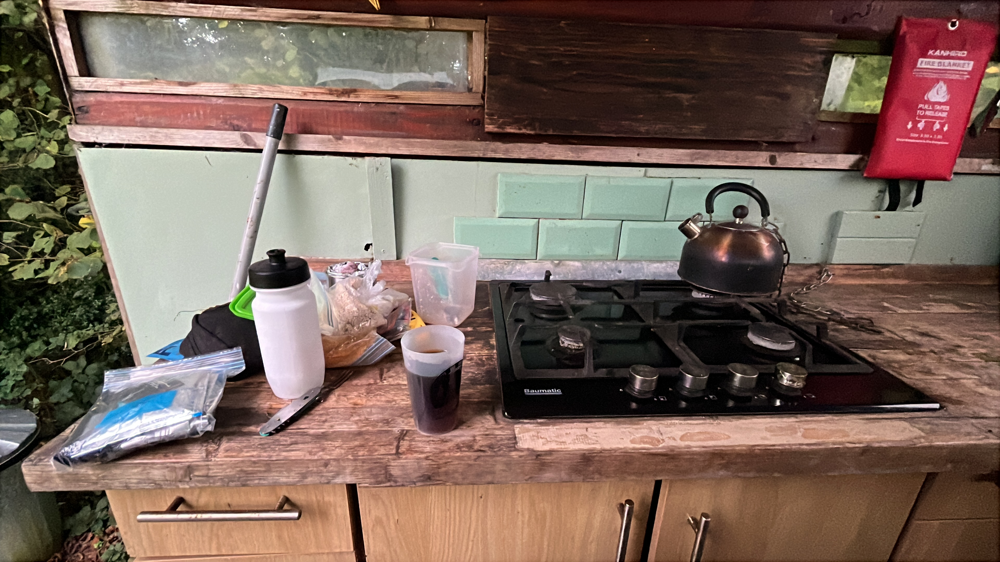

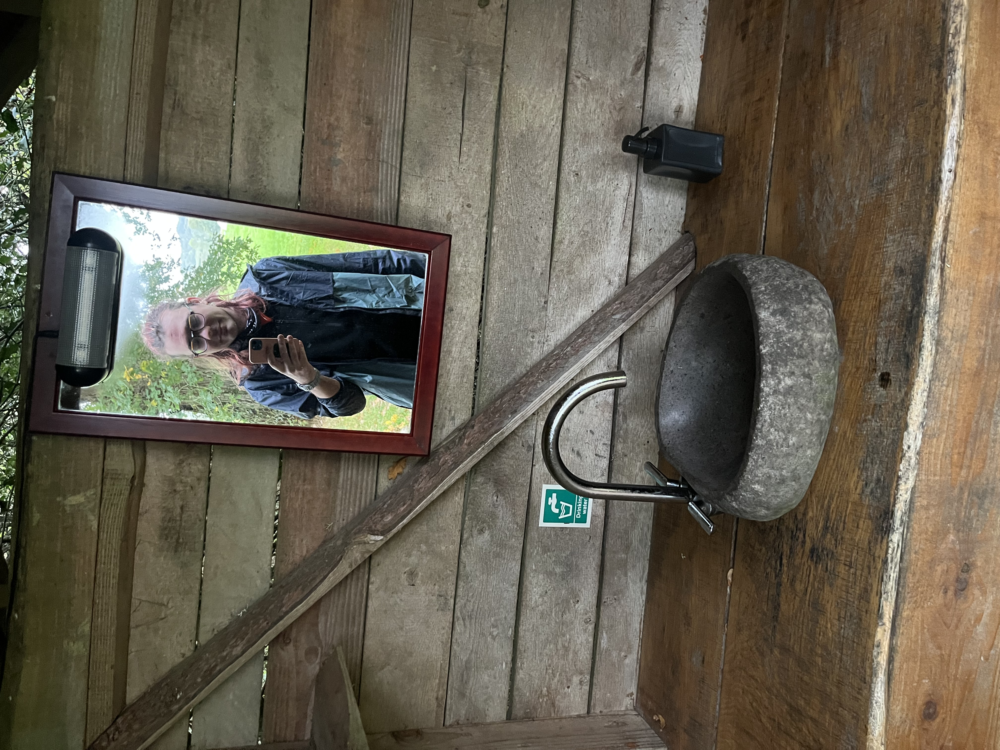

 surprise : mon pneu avant est à nouveau dégonflé. Je change finalement de chambre à air pour essayer d’être tranquille pour la journée.

Au programme : 74 km et 820 m de D+. Je quitte le camping un peu tard, vers 9 h 30, mais la matinée se déroule très bien. Encore une fois, de belles routes de campagne désertes et de jolies descentes

Vers 13 h, pause dans un petit restaurant au bord d’une route passante pour bien recharger ma batterie externe à fond.

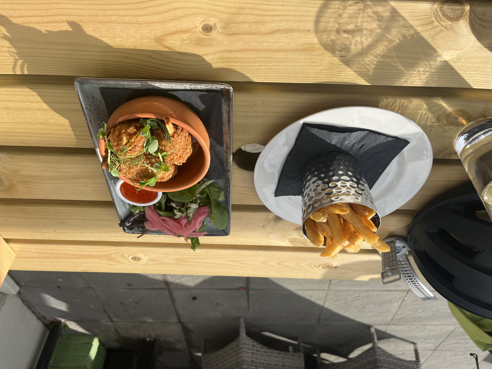

L’après-midi est un peu plus compliquée. détour pour éviter une nationale que je n’avais pas anticipée et nouvelle crevaison à la roue avant…. Sauf qu’au moment de démonter la chambre à air, impossible de trouver le trou. Je la regonfle à fond pour voir si elle tient.

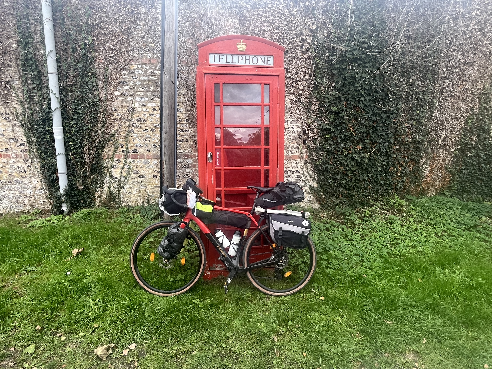

Je poursuis vers Winchester, qui est une ville très vallonnée. Dans une grosse côte au milieu des voitures, mon pneu se dégonfle à nouveau. Arrêt, démontage et inspection de la chambre à air. Cette fois, je finis par trouver le minuscule trou et je le répare avec une rustine. On croise les doigts

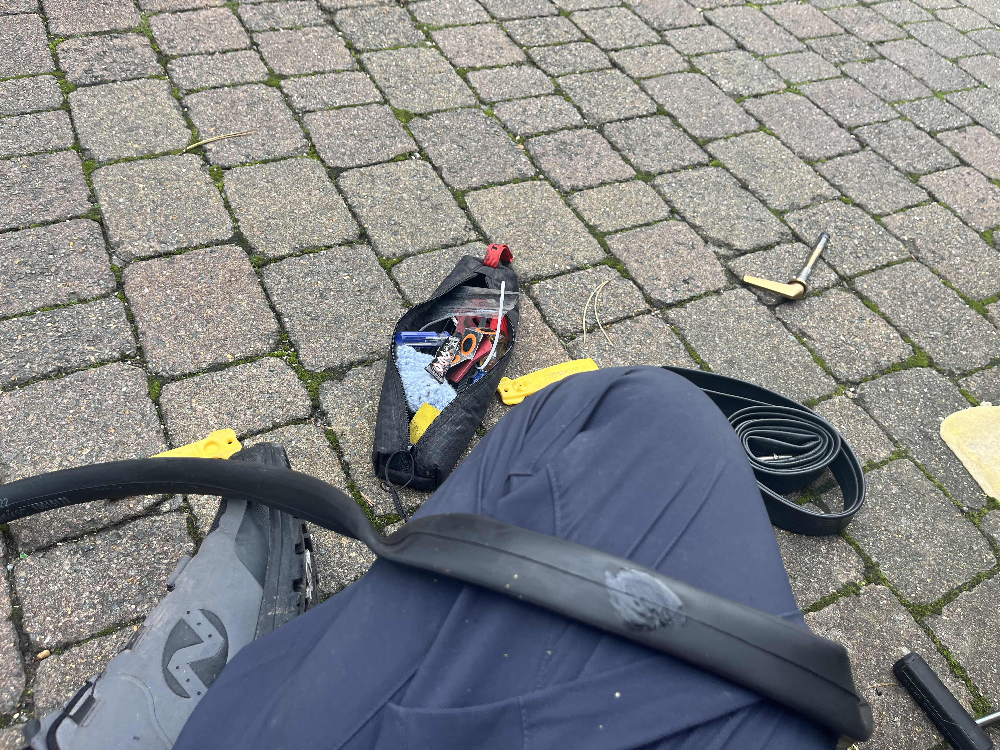

Après avoir traversé Winchester, j’arrive à King’s Somborne, où je rachète quelques provisions. Jhesite entre trouver un coin pour bivouaquer ou parcourir les 8 km qui me séparent du camping ? Je décide finalement de tenter un nouveau bivouac,. je toque à la porte d’une maison pour remplir ma grosse poche à eau de 3 litres et mes bidons pour me laver et cuisiner ce soir et demain matin. Un monsieur très sympathique à la barbe blanche, aux cheveux longs et qui porte un pull de l’ESA m’ouvre et accepte volontiers de remplir mes gourdes.

Sa compagne me propose ensuite quelque chose à manger. Je refuse dans un premier temps, mais elle insiste gentiment et me voilà attablé avec Mark et Jill ! Iels me racontent leurs années passées aux pays bas, où Mark travaillait à l’ESA sur les satellites météo qui détectent les éclairs, des géostationnaires qui capturent à une fréquence de 1 kHz si j’ai bien retenu les explications !

Au moment de repartir pour trouver mon coin de bivouac, je consulte une dernière fois les prévisions météo. Beaucoup de pluie pendant la nuit. Le soleil commence également à se coucher, et l’idée de planter la tente sous une grosse averse devient moins séduisante.

Je demande à mes sympathiques hôtes s’il serait possible de planter la tente dans leur jardin. Ils acceptent volontiers, mais vont même plus loin : ils me proposent un lit de camp dans leur grande véranda !

Bonne nuit au sec et à demain !

# mercredi 14 octobre 18:55

Réveil très sympathique sur mon lieu de bivouac. La nuit s’est très bien passée. C’est sûr que lorsqu’on est tout seul dans la forêt, on entend plein de bruits bizarres et on se demande si c’est un sanglier, un chien qui aboie au loin ou simplement une voiture qui passe. Mais tout s’est bien passé !

Je démonte la tente avec le lever du soleil, puis profite de mon petit déjeuner avec une très belle vue depuis le sommet de la colline.

Encore quelques petits soucis techniques au réveil : le porte-bagages qui grince et qui nécessite un resserrage complet, la boue et l’humidité qui font grincer mes freins, et mon pneu avant qui est bizarrement à plat. Je soupçonne plutôt la valve de la chambre à air qu’une nouvelle crevaison. Après un petit check-up mécanique et des préparatifs rapides, c’est parti pour une journée de 74 km et 753 m de D+ prévus, beaucoup plus roulante que la veille !

La première partie de la matinée traverse un petit marais un peu gras mais calme et sympathique. J’y croise plusieurs randonneurs avant de rejoindre une ville où je profite d’un Tesco pour reprendre fruits et barres

La sortie de la ville est un peu moins agréable, avec pas mal de circulation, mais je retrouve rapidement les routes de campagne, en bon état et presque désertes

Vers midi, le ciel commence à se couvrir et je tombe sur une superbe petite taverne qui m’emmène tout droit à Rivebois (celles et ceux qui ont la référence comprendront). J’y prends un café au coin du feu, discute avec la patronne et évite la pluie de justesse.

erreur stratégique : je n’en profite pas pour recharger ma batterie externe, qui commence à fatiguer après la nuit de bivouac

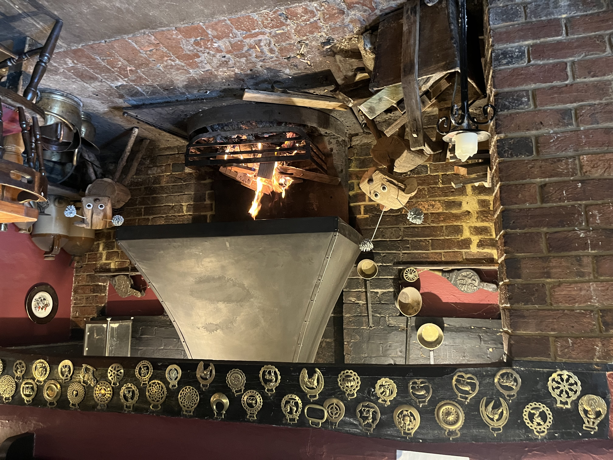

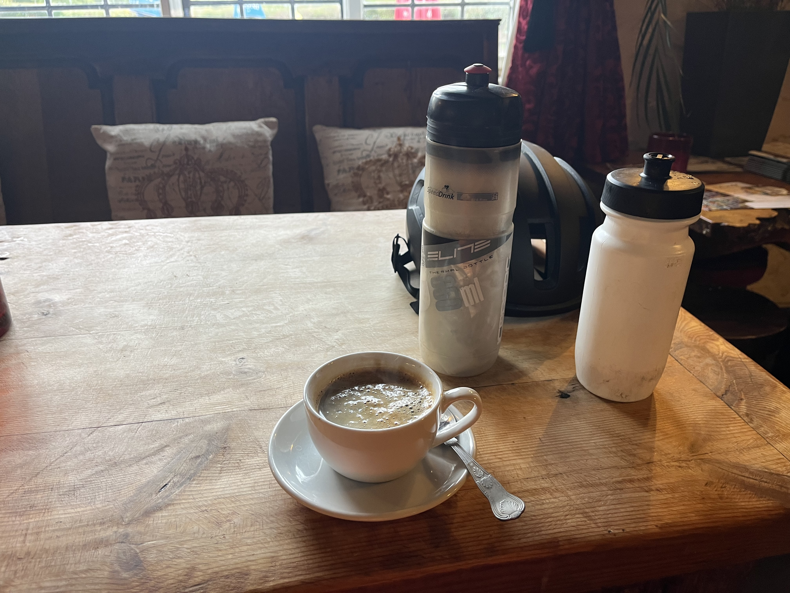

L’après-midi, du soleil, des routes très roulantes et peu de circulation. Quelques petites montées qui passent relativement bien tant qu’elles ne dépassent pas 5 à 6 %. Au-delà, pas le choix, il faut pousser le vélo mais avec le sourire et la satisfaction d’être en quasi totale autonomie grâce à tout le matériel que je transporte

J’arrive finalement très tôt au camping : 16 h 30 ! Pour me récompenser, petit détour par M&S, ( un supermarché un peu fancy) pour y prendre un soda à la rhubarbe et des chips pour ce soir

Le camping est un immense terrain avec une cuisine extérieure, des bancs, des douches solaires et des toilettes à compost. Le rêve, je me lave même les cheveux

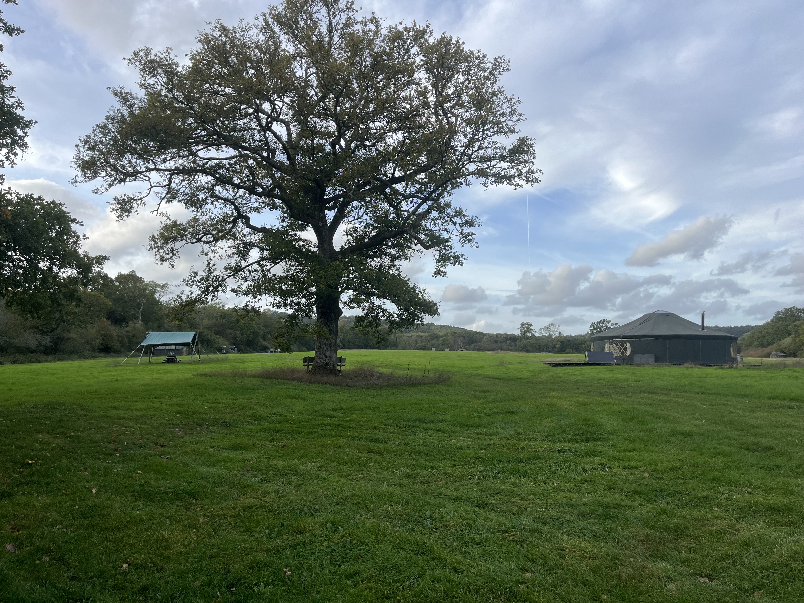

.Je rencontre la propriétaire, qui accepte très gentiment d’emporter ma batterie externe chez elle pour la recharger

Je ne sais pas si c’est parce que je commence à trouver mon rythme ou si je prends un peu trop. La confiance, mais cette journée s’est vraiment très bien passée. De bonnes jambes, un parcours agréable et seulement une petite gêne au genou, qui disparaît au repos, a surveiller et sans trop forcer. Qui veut aller voyager loin ménage sa monture!

Il reste encore quelques éléments à gérer pour la suite du voyage. Le soleil se lève de plus en plus tard et se couche de plus en plus tôt : je dois lever le camp pour le lever du soleil si une grosse journée m’attends pour éviter de rouler trop le soir.

En parallèle, avec la précieuse aide de Véronique, on gère les derniers détails administratifs de la soutenance de thèse par mail interposé! J’ai aussi reçu un coup de fil de France travail qui valide mon allocation chômage! C’est peut etre un signe que je vais pouvoir continuer à voyager encore plus longtemps que prévu qui sait…

update 20:11: je viens de marcher les 400 m qui me séparaient de la maison de la proprio dans le noir, le froid et la brume anglaise brrr c'est Halloween avant l'heure 

# mardi 13 octobre 20:30

Deuxième jour de voyage, et déjà l’une des plus grosses journées prévues: 90 km et 1 000 m de D+. Sauf que la trace s’avère bien plus gravel que prévu, surtout sur la première moitié. Les voies vélo annoncées en ligne sont en réalité des chemins très rocailleux, avec des pierres tranchantes comme des silex.

  Ce qui devait arriver arriva : trois crevaisons successives sur ma roue avant. Les mèches s’enchaînent et tout mon liquide préventif se fait la malle donc : passage en chambre à air. C’est pas super drôle de démonter sa roue avant en plein milieu de la forêt, mais il faut bien repartir ! Je rajoute à ma liste de choses essentielles en voyage à vélo: de l’eau, à manger, de la lumière, et de l’air dans les pneus. Je fais un détour pour trouver un magasin de sport pour reprendre une chambre de secours. dur dur pour le moral

Après seulement une petite quarantaine de kilomètres parcourus avant midi, je trouve une supérette pour manger un morceau. J’ai aussi la joie de profiter d’une petite drache éclair anglaise qui me trempe juste avant d’arriver, mais je suis bien équipé, donc tout roule !

L’après-midi est plus sympa. La deuxième partie de l’itinéraire est un peu plus roulante, avec davantage de routes de campagne, et météo au top.

Une route fermée “même aux cyclistes”  vient compliquer les choses. Elle me force à choisir entre tenter de traverser le parc d’un château / résidence de luxe ou faire un détour par une sorte de nationale limitée à 90 km/h. Je tente ma chance du côté du château, mais on me fait rapidement comprendre qu’il est absolument impossible de traverser le parc privé à vélo. Donc détour de 5 km, avec une portion le long d’une nationale peu agréable.

dernier obstacle de la journée : 1 km de pente à 12 %. Je traîne mes 125 kilos cumulés pied à terre en poussant jusqu’en haut

Les derniers kilomètres se déroulent sur une petite route forestière qui serpente entre de belles propriétés, avec leurs maisons d’architecte et leurs grands jardins

Il me reste encore 15 km jusqu’au camping que j’avais repéré, mais je tombe sur un petit coin de parc nature entre des propriétés privées. Je trouve une super vue depuis le sommet de la colline avec un banc pour moi tout seul!

J’y mange un morceau en profitant du paysage, puis j’attends le coucher du soleil pour installer la tente à l’écart des sentiers.

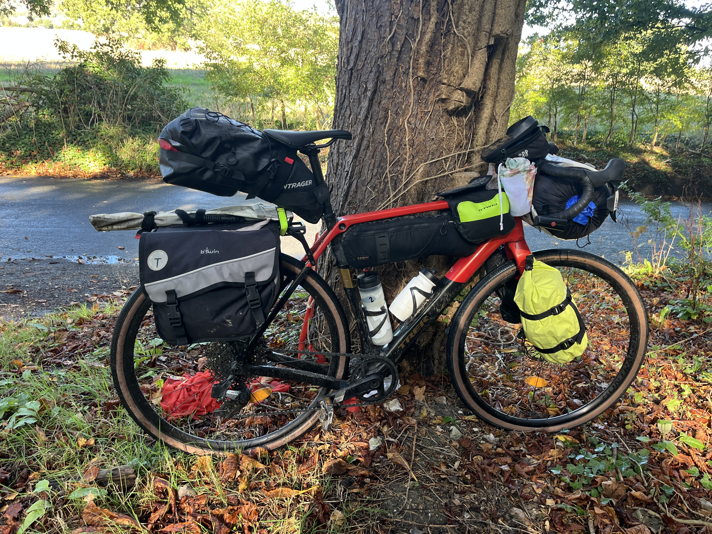

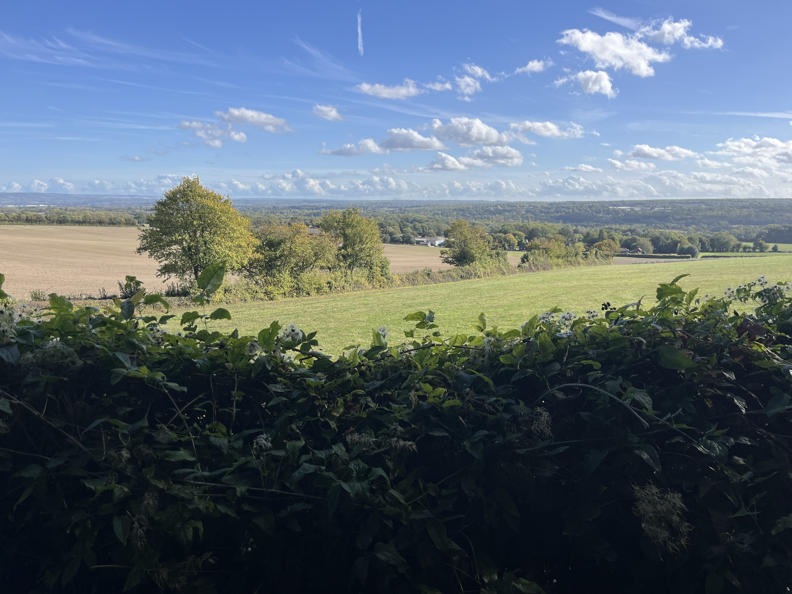

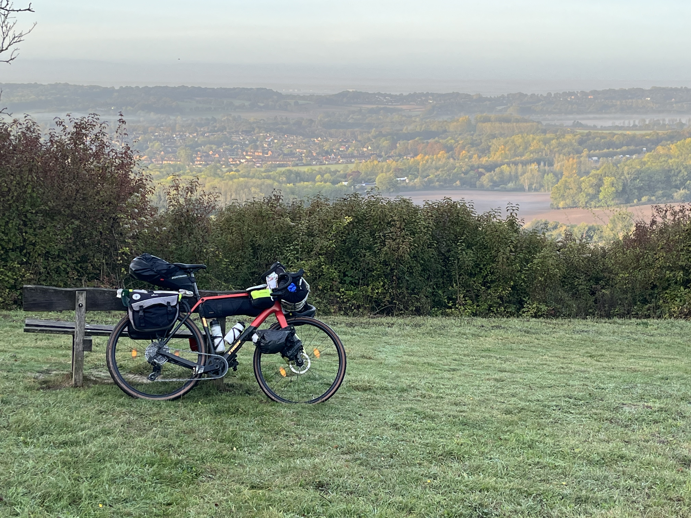

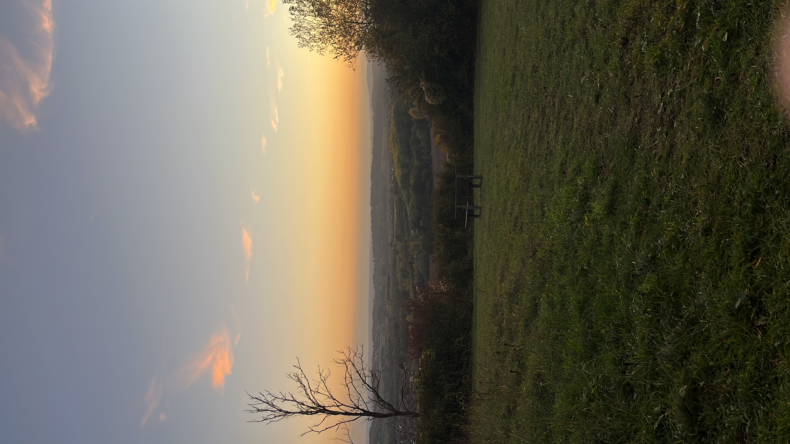

Au final, 88 km et 1 200 m de D+ au compteur! Demain réveil tôt pour ne pas me faire surprendre par les promeneurs matinaux!

pareillement j'enverrai les photos plus tard bizarrement on capte mal dans la forêt 

# lundi 12 octobre 19:18
Après 20 minutes de vélo entre la gare de Calais et le ferry, je passe les contrôles aux frontières rapidement. Il me reste ensuite 1h30 à attendre avant l’embarquement. je rencontre un couple anglais fort sympathique avec qui je passe toute la traversée. On discute beaucoup, notamment de leurs voyages à vélo entre leur péniche en Angleterre et les quatre coins de la France! 

Arrivé à Douvres, je longe la côte pendant une quinzaine de kilomètres avant de tourner dans les terres. en haut des White Cliffs, le vent est très fort, de face et de côté. en plus je prends doucement en main mon vélo chargé à bloc, ce n'étais pas facile facile. sur le retour à la fin de mon voyage je devrai l'avoir dans le dos !

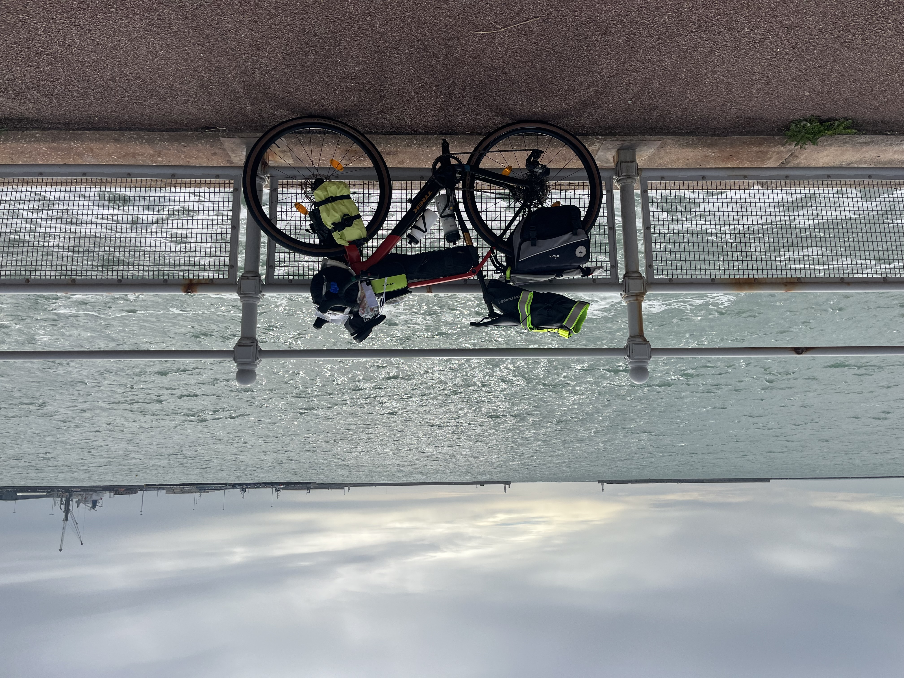

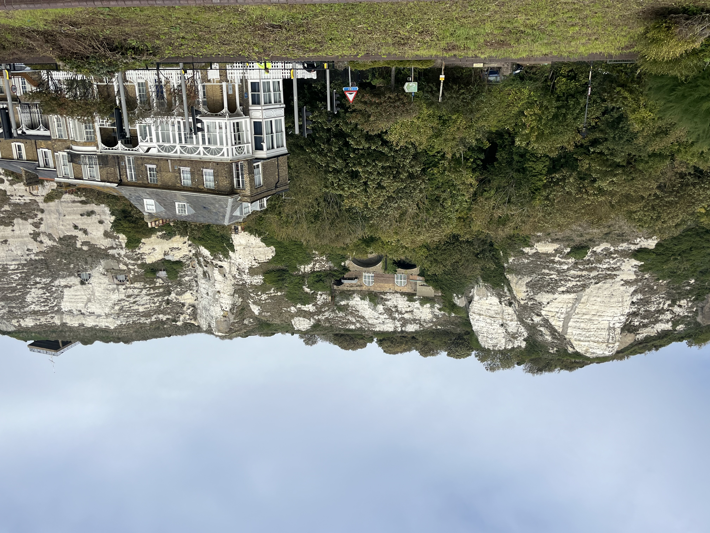

Au moment de tourner dans les terres, malheur : une sacoche de mon porte-bagages arrière est restée ouverte et j’ai perdu une pochette ! Il y avait dedans ma casquette, mes couvre-chaussures et mes gants d’hiver. je repars dans l’autre sens pour remonter environ 5 km. Je finis par retrouver la fameuse sacoche au bord de la route, pile au moment où je commençais à perdre espoir. Ouf !

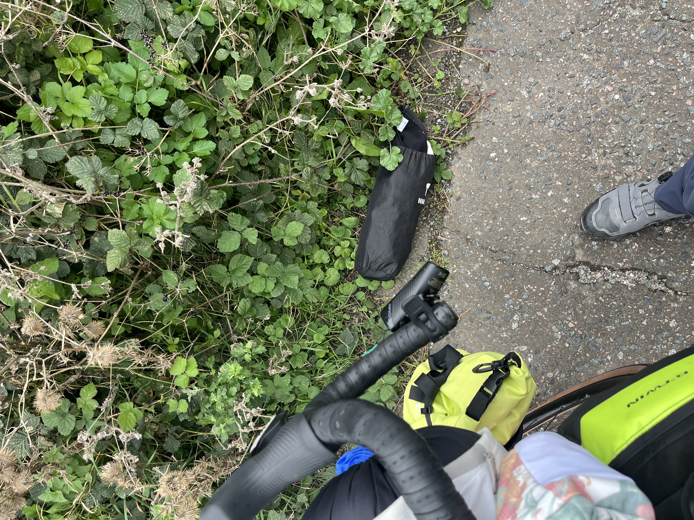

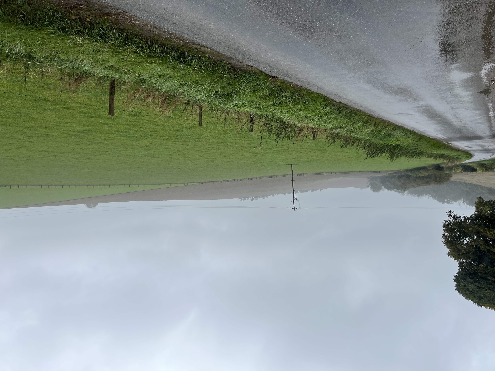

Demi-tour, et cette fois, direction les petites routes de campagne anglaises. Pas mal de D+ moi qui suis habitué au plat pays mais très peu de voitures. 

La météo se gâte progressivement. Après le vent, place à la pluie et au brouillard. J’allume tous mes phares et reste bien visible tout roule

après 45km, le camping est tout proche et je devrais y arriver vers 17 h

 là, malheur bis : le dieu du tubeless semble vouloir ma peau. Une entaille de 3 mm sur le pneu avant refuse de se reboucher avec le liquide préventif. obligé de mettre une mèche dans mes pneus tout neufs, qui ont à peine 50 km au compteur. Un peu frustrant, mais c’est la vie !

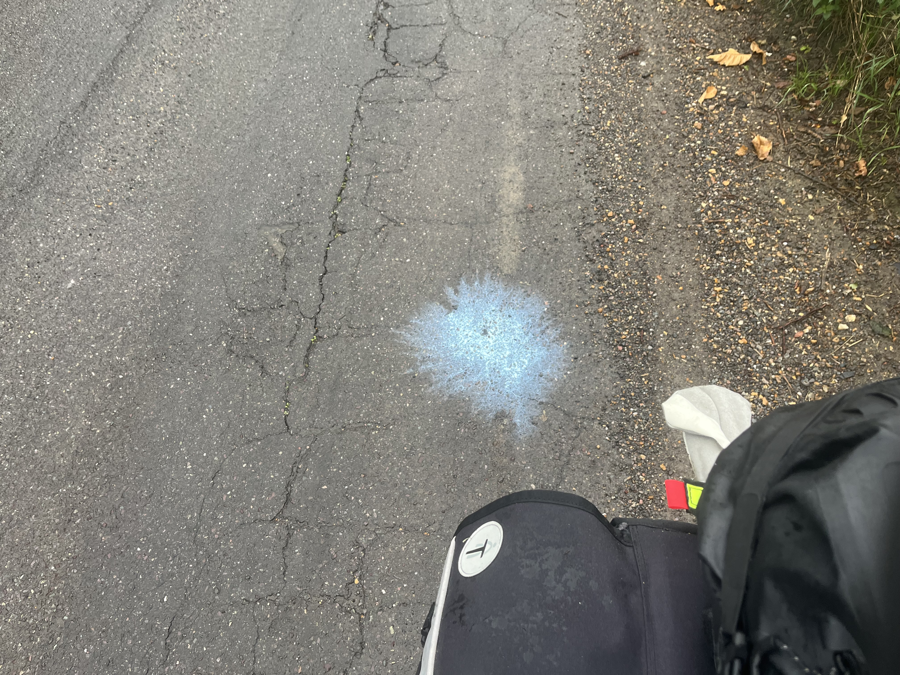

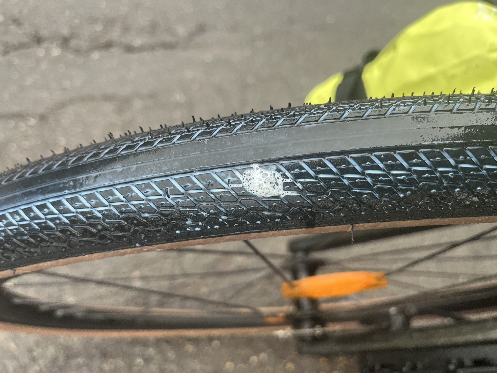

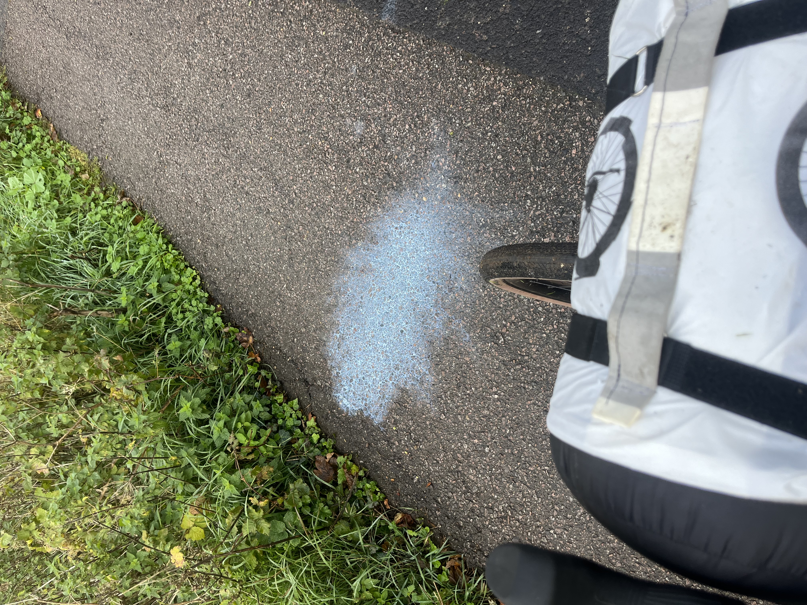

Enfin arrivé au camping, qui est plutôt bien équipé, j'ai un grand champ pour moi tout seul. Je suis juste à côté des points d’eau et j’ai accès à une petite kitchenette abritée et des douches. J’installe rapido ma tente et mange ma purée PST épicée lyophilisé (20/20)

Merci pour tous vos commentaires!! je mettrai des photos plus tard ici car j'ai très peu de réseau !

# lundi 12 octobre 7:03

Bonjour tout le monde ! j'écris ce message depuis le train pour Calais qui m'emmène au port pour prendre mon ferry ! j'ai pas mal hésité à écrire en anglais ou en français mais je pense continuer en français !

j'ai rendu mon manuscrit de thèse fin septembre et je pars maintenant pour mon voyage à vélo en Angleterre ! Le prétexte de ce voyage étant un concert à Portsmouth le 25 octobre du groupe de rock anglais "Sea Power" que j'affectionne énormément!

je prends ce matin un train Lille - Calais puis un ferry pour Douvres qui devrait me faire arriver sur place vers midi heure locale, pour ensuite rouler environ 50 km jusqu'à mon premier camping près de Ashford!

ma trace est très majoritairement route de campagne ou chemin compact, sauf sur mes 2-3 derniers jours qui sont très (peu être trop ?) Gravel pour éviter de longer les villes côtières assez urbaines. je prendrai normalement un morceau de la "South Down Way" qui est un itinéraire VTT assez réputé !

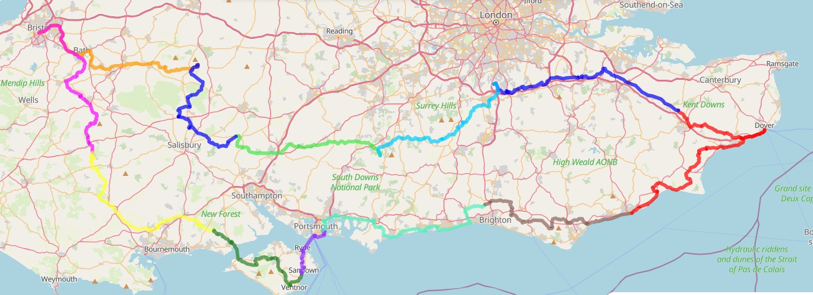

mon vélo est bien prêt avec toutes mes affaires, je suis parti avec l'équivalent de environ 10 repas secs à réhydrater fait maison, et quasiment assez de barres et de snack pour tout le voyage (ce qui est certainement bien trop mais j'aurai moins à m'arrêter !)

je teste un peu trop de matériel à mon goût même si j'ai fais le maximum pour tout rouler au moins une fois avant de partir :
j'ai installé un porte bagage et 2 sacoches à l'arrière de mon vélo pour pouvoir transporter mes vêtements chauds (dont je n'ai pas tellement besoin lors de mes sorties printanières) et 2 dry bag de fourche pour y transporter ma nourriture et système de sommeil (matelas, liner de sac)
j'ai aussi un super sac de couchage cumulus tout neuf qui devrais me garder bien chaud!!

j'ai peut être pris un peu trop de matériel je suis très très loin d'être ultra light : le vélo + le matériel pèsent 29.2 kg !! pour un total avec le cycliste de 122.8 kg, 2.2kg sous la limite de charge du trek ouf, sachant que ça devrait aller en s'améliorant sur la route !

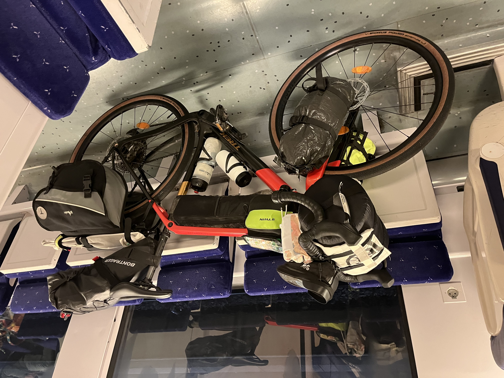

<h2>Commentaires</h2>
vous pouvez commenter ici, n'hésitez pas à préciser un pseudo ou votre nom pour que je vous reconnaisse !

  <cmmnts-widget
    site-key="my-blog-wieckowiak"
    page-id="uk-trip-wieckowiak"
    max-height="none">
  </cmmnts-widget>

     
<h2>End of Page</h2>